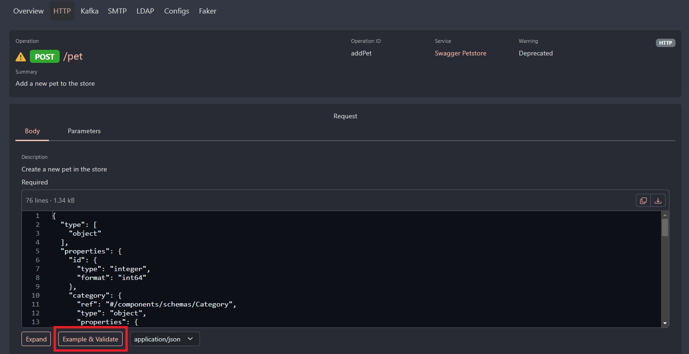
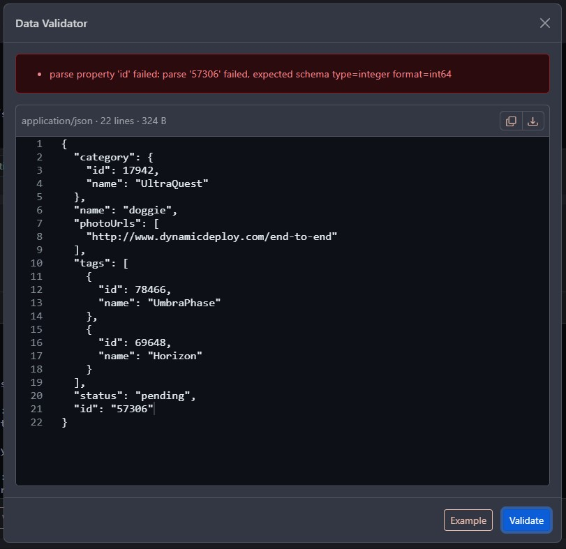

# Using Mokapi Dashboard

The dashboard provides graphical displays of your mock APIs and helps developers 
simulate real API responses during the development and testing phases. It allows 
you to validate data against the specification as well as generate new random, realistic and valid data.
This is useful during the early stages of development, facilitating rapid prototyping, testing error handling, 
and ensuring the mock APIs works seamlessly under various scenarios.

The dashboard is available on port 8080 by default. Open `http://localhost:8080` from your browser.

<!-- screenshot: new layout with sidebar and tabs (replaces dashboard-overview-mock-api.png, which shows the classic layout) -->

## Layout

The dashboard has four areas: the header, the activity bar on the left, the sidebar next to it
and the tab bar with the open view.

The header contains the Mokapi logo, the links to the dashboard and the documentation, the
version, the documentation search and the theme switch.

### Activity bar

The icons of the activity bar open the main areas:

| Icon     | Description                                                                         |
|----------|-------------------------------------------------------------------------------------|
| Services | Shows the sidebar. Click it again to collapse or expand the sidebar.                |
| Search   | Shows the search panel in the sidebar. Click it again to collapse or expand the sidebar. Shown only if search is enabled, not in the demo. |
| Jobs     | Opens the scheduled jobs as a tab. Always shown.                                    |
| Configs  | Opens all configuration files as a tab.                                             |
| Faker    | Opens the Faker tree as a tab. Shown only in the live dashboard, not in the demo.   |

Press `/` anywhere in the dashboard to open the search panel and focus its input. If the sidebar
is collapsed, Mokapi expands it, or opens the overlay in a narrow window. In the Classic view,
`/` opens the search page.

### Sidebar

The sidebar lists everything Mokapi serves. From top to bottom it contains:

- a filter field (see [Filter the sidebar](#filter-the-sidebar))
- **Overview**, the start page with runtime metrics and all services
- **Pinned**, your pinned views (see [Pinned](#pinned))
- one group per protocol that has at least one service, in the order HTTP, Kafka, MQTT,
  Websocket, Mail and LDAP

Each group lists its services alphabetically with the number of requests or messages. For HTTP
services, a red dot shows that the service handled requests with errors. Click a service to open
its view.

Click the group heading to open the page of the protocol with its metrics, services and log.
The chevron next to the heading collapses or expands the group.

### Filter the sidebar

Type in the filter field to find a service, an endpoint, a topic, a channel or a mailbox. The
filter ignores case and matches:

- the service name
- the path, topic, channel or mailbox name
- the HTTP method, for example `post`
- the tag

The sidebar then shows the matches grouped by service, with a summary such as "5 matches in 2
services". For each service it lists at most 6 items. If there are more, the entry "N more in
`<service>`" opens the service view. Use the clear button or press `Escape` to empty the filter.

### Search panel

The search panel searches across your HTTP requests, Kafka messages, mails, LDAP entries,
configuration files and events. Open it with the Search icon or the `/` key. Mokapi runs the
search one second after your last key press if the text has at least 3 characters and doesn't
end with `:`. Press `Enter` to search immediately.

Search is enabled by default. If you turn it off with `api.search.enabled: false` (CLI flag
`--no-api-search-enabled`, see the [configuration reference](/docs/configuration/reference.md)),
the Search icon and the panel are hidden. They're also hidden in the demo dashboard.

<!-- screenshot: search panel with results, facet selects and the Search tips section -->

If the API returns facets, the panel shows one select for each of them, for example Type, to
restrict the results. The panel shows "Showing 20 of 57 results" and loads 20 results at a time.
Click **Load more** to append the next 20.

Results don't refresh by themselves. The search runs again when you click **Refresh**, change
the text or a facet, or open the panel.

Each result has two lines. The first shows a badge with the HTTP method or the type, the title
and the status. The second shows the service, the time and the matched text. The result that is
open in the active tab is highlighted.

Click a result to open it in the active tab. Ctrl+click, Cmd+click or middle click opens it in a
new tab, as described in [Tabs](#tabs).

Click **Search tips** to show or hide the query syntax. **Open all results** opens the full
search page with the same text and facets. It's hidden while the input is empty.

Press `Escape` in an empty input to switch back to Services. If the input contains text,
`Escape` does nothing, so you don't lose your search by accident.

Mokapi saves the search text and the facets in the browser, separately for each window, and
restores them after a reload. After a reload the sidebar shows Services.

### Tabs

Every tab is a page of the dashboard, so the URL in the address bar always shows the active tab.
You can copy it, bookmark it or share it. The title of an HTTP endpoint tab starts with the
method.

How a click opens a view depends on how you click:

| Action                                    | Result                                                                  |
|-------------------------------------------|-------------------------------------------------------------------------|
| Click                                     | Activates the tab if the target is already open, otherwise replaces the active tab |
| Ctrl+click, Cmd+click or middle click     | Always opens a new tab, even if the target is already open              |
| Middle click on a tab or click on x       | Closes the tab                                                          |

This applies to the sidebar, the activity bar, pinned entries and to links and table rows
inside a view. The rows of the HTTP request log, the LDAP request log, the mail log, the jobs log and the Kafka, MQTT and WebSocket message logs are an exception: a
click selects the row and shows its details next to the table, see
[Request log](/docs/http/dashboard.md#request-log),
[Kafka message log](/docs/kafka/dashboard.md#message-log),
[LDAP request log](/docs/ldap/dashboard.md#request-log),
[Jobs](#jobs),
[Mail log](/docs/mail/dashboard.md#mail-log),
[MQTT message log](/docs/mqtt/dashboard.md#message-log) and
[WebSocket message log](/docs/websocket/dashboard.md#message-log).

The dashboard keeps at most 10 tabs. If you open another tab, or the tab doesn't fit into the
row, Mokapi closes the tab you used least recently. Resizing the window never closes a tab. If
the window is too narrow, the tabs that don't fit move into a **+N** menu at the end of the bar,
and the active tab stays visible.

Mokapi saves your open tabs in the browser and restores them after a reload. Each browser window
keeps its own tabs. If you open the dashboard with a URL, for example from a link or a bookmark,
the saved tabs are restored and the URL opens as an additional tab. The browser's back and
forward buttons work as usual. Because a click replaces the active tab, back shows the previous
view in the active tab.

Switching to a tab loads its view again, so data is fetched again and the scroll position starts
at the top.

### Pinned

Pin the views you need often. Click the star in a tab to pin or unpin it. In the service views,
the rows of endpoints, topics and channels have a star as a shortcut.

Pinned views appear in the **Pinned** section of the sidebar and behave like any other sidebar
entry, including Ctrl/Cmd+click and middle click. If the target no longer exists, for example
because the API was removed from your configuration, the entry stays in the list but is greyed
out. Use its remove button to delete it.

Pinned views are saved in the browser and restored after a reload.

### Group by tag

The lists of HTTP endpoints, Kafka topics, MQTT topics and Websocket channels have a switch with
two options:

- **A-Z** shows one list sorted alphabetically. This is the default.
- **By tag** groups the rows under a heading per tag, with the tag's description from your
  OpenAPI or AsyncAPI specification. Rows without a tag are listed last under "Untagged".

Mokapi remembers your choice for each service.

<!-- screenshot: HTTP endpoint list grouped by tag -->

### Narrow windows

In windows narrower than 768 px, the sidebar starts collapsed. Click the Services icon to open
it as an overlay on top of the view. Clicking an entry opens it and closes the overlay. Mokapi
remembers whether the sidebar and each protocol group is collapsed or expanded.

### Classic view

The previous layout with protocol tabs and a breadcrumb is still available as a temporary
fallback. Click **Classic view** in the header to switch to it, and **New view** to switch back.
Mokapi remembers your choice. URLs are the same in both layouts.

Classic view exists only in the live dashboard and will be removed in a later release. The
[demo dashboard](/dashboard-demo) always uses the new layout.

## Working with Dashboard

The dashboard displays key metrics like request logs, 
response times, and error rates, offering a comprehensive 
overview of how the mock API behaves under different conditions.

### Jobs

The Jobs page shows your scheduled jobs. A job is a function you register with
[cron](/docs/javascript-api/mokapi/cron.md) or [every](/docs/javascript-api/mokapi/every.md) in a
script. Open the page with the Jobs icon of the activity bar, which is always shown. In the Classic
view, the Jobs tab appears only after a job has run for the first time.

The page has two tabs, **Jobs** (the default) and **Runs**.

#### Jobs tab

The Jobs tab has one row per registered job, sorted by name:

| Column   | Description                                                                                       |
|----------|---------------------------------------------------------------------------------------------------|
| Name     | The name of the job                                                                               |
| Schedule | The cron expression or the interval of the job                                                    |
| State    | **Scheduled**, **Finished** or **Cancelled**                                                      |
| Runs     | `3 / 10` if the job has a limit of runs, otherwise only the number of runs                        |
| Next Run | The date and, while it's in the future, a countdown, for example `2026-11-16 12:00:00 (in 1h 2min 3s)`. `-` if the job has no further run. |
| Last Run | The status of the last run and its time. The time links to the run.                               |
| File     | The script file of the job. It links to the configuration of the script.                          |

A job is **Scheduled** while it has a next run. **Finished** means an `every` job that used all
its runs. Mokapi keeps a finished job in the list instead of removing it.

Click a row to open the Runs tab, filtered by the name of the job. If no job is registered, the tab shows "No jobs defined" with
links to the documentation of `every` and `cron`.

The name is the name of the script file, for example `jobs.ts`, unless the job sets the `name` tag.
Jobs of one script therefore share the same name by default. Set the `name` tag in the
[arguments](/docs/javascript-api/mokapi/eventhandler/scheduledeventargs.md) to tell them apart:

```typescript
import { every } from 'mokapi'

export default function() {
    every('1m', () => {
        // sync orders
    }, { tags: { name: 'sync-orders' } })

    every('10m', () => {
        // clean up
    }, { tags: { name: 'cleanup' } })
}
```

#### Runs tab

The Runs tab lists the runs of your jobs, newest first. The log is titled "Recent Jobs" and is
always shown, also when it's empty. An address with `?job=<id>` opens this tab with the run selected.

<!-- screenshot: jobs log with the detail panel open on the Logs sub tab -->

The log has these columns:

| Column   | Description                                                                          |
|----------|--------------------------------------------------------------------------------------|
| Status   | **Success**, **Warning** or **Error**, as a badge                                    |
| Name     | The name of the job. Ctrl+click, Cmd+click or middle click opens the run in a new tab. |
| Schedule | The cron expression or the interval of the job                                       |
| Time     | When the run happened                                                                |
| Duration | How long the handler ran                                                             |

Mokapi derives the status from the run. The status is **Error** if the run failed or the script
logged a message with level `error`, and **Warning** if the script logged a message with level
`warn`. Otherwise it's **Success**, also if the run has no logs.

Click a row to open the run next to the table. The selected row is highlighted. The top of the
panel shows the status, the name and the time of the run. Below the head, the panel has two sub
tabs:

| Sub tab | Content                                                                                           |
|---------|---------------------------------------------------------------------------------------------------|
| Logs    | The error of the run, if there was one, and the messages the script logged. This is the default.  |
| Details | Schedule, Runs, Duration, Next Run and the tags of the job                                        |

The Runs field shows `3 / 10` if the job has a limit of runs, otherwise only the number of runs.
Next Run shows the date and, while it's in the future, a countdown, for example
`2026-11-16 12:00:00 (in 1h 2min 3s)`. The countdown keeps running while the log is paused. Next Run
is `-` if the job has no further run. The tag `file` links to the configuration of the script.

<!-- screenshot: panel with the Details sub tab and the countdown in Next Run -->

Click **Open as tab** to show the run in the full view, `/dashboard/jobs/<id>`. A click replaces the
active tab, Ctrl+click or Cmd+click opens a new one. In the new layout, Ctrl+click, Cmd+click or
middle click on the name does the same without selecting the row. The full view shows the same
information one below the other.

Use the arrow keys up and down to select the previous or next run of the current page. Press
`Escape` or click **Close** to close the panel. The keys are ignored while you type in an input.

The selected run is part of the address (`?job=<id>`). After a reload, the panel opens again, and
you can copy the address to share the run. Mokapi only keeps a limited number of events in memory.
If Mokapi has dropped the event, the panel and the full view show "Job not found".

Filter the log with the **Name** chip. Click **+ Add filter**, then **Name**, and type the name of
a job. The filter matches the name exactly and is case-sensitive, so `Jobs.ts` doesn't find
`jobs.ts`. The input suggests the names of the runs on the current page. A job that only ran on
another page isn't suggested, but you can still type its name. Two scripts with the same file name
share one name unless they set the `name` tag. Mokapi saves the filter in the browser and restores
it after a reload.

Auto refresh and **Pause** work as in the [mail log](/docs/mail/dashboard.md#pause-the-log). The
demo dashboard has no Pause button. In the Classic view, the log has the same panel, filter and
**Pause** button.

### Generate sample data from the specification

Some API types support generating sample data and validating data against the specification 
(namely HTTP and Kafka). Here is a quick overview with the HTTP example. To create sample data for a 
request body, navigate to an HTTP endpoint and look for the "Example & Validate" button.
In the opened dialog you can create, edit, validate, copy to the clipboard and download 
your sample data.



### Validate data

In the same dialog where we can create sample data, we can also validate it. The next image
shows an example of an HTTP REST request body that is not valid according to the specification.



## How to customize?

There are several options to customize the dashboard to fit your environment.

### How to change the default port?

You can change the default port on which the dashboard should run as follows:

```bash tab=CLI
--api-port 5000
```
```bash tab=Env
MOKAPI_API_PORT=5000
```
```yaml tab=File (YAML)
api:
  port: 5000
```

### Adding a Path Prefix

Many applications are not hosted in the root (/) of their domain. For example,  
Mokapi's Dashboard could live at `example.com/mokapi`. In this case, a prefix must be 
added to the dashboard, so a link to `/dashboard` should be rewritten as `/mokapi/dashboard`.

```bash tab=CLI
--api-path /mokapi
```
```bash tab=Env
MOKAPI_API_PATH=/mokapi/dashboard
```
```yaml tab=File (YAML)
api:
 path: /mokapi
```

### Behind a Reverse Proxy

If the dashboard is running behind a reverse proxy and the proxy strips segments from the request 
URL, you must set the base path. For example, the URL to the dashboard is `example.com/app/mokapi`
but the request URL to your host running the dashboard is `/`

```bash tab=CLI
--api-base /app/mokapi
```
```bash tab=Env
MOKAPI_API_BASE=/app/mokapi
```
```yaml tab=File (YAML)
api:
 base: /app/mokapi
```

Further configuration options are documented [here](/docs/configuration/reference.md).

## API

Mokapi exposes a set of information through an API handler, 
such as the configurations, logs and metrics. The API is available at the same port 
as the dashboard but on the path /api

### Endpoints

You can find the OpenAPI specification of these endpoints 
[here](https://github.com/marle3003/mokapi/blob/master/examples/mokapi/dashboard.yml)

| Path                              | Description                            |
|-----------------------------------|----------------------------------------|
| /api/info                         | get information about mokapi's runtime |
| /api/services                     | list of all services                   |
| /api/services/http/{name}         | Information about the http service     |
| /api/services/kafka/{name}        | Information about the kafka cluster    |
| /api/services/mail/{name}         | Information about the smtp server      |
| /api/services/kafka/{name}/groups | list of kafka groups                   |
| /api/events                       | list of events                         |
| /api/events/{id}                  | get event by id                        |
| /api/metrics                      | get list of metrics                    |
| /api/schema/example               | returns example for given schema       |
| /api/services/http/validate       | validate an HTTP request and response  |
| /api/jobs                         | list of all scheduled jobs             |

### Validate a request and response

`POST /api/services/http/validate` checks an HTTP request and its response against the
OpenAPI contracts loaded in Mokapi. Use it to verify that the traffic of your application,
or the output of a test, matches the specification. The endpoint has no side effects: Mokapi
doesn't create an event or a metric and doesn't run any script.

```bash
curl -X POST http://localhost:8080/api/services/http/validate \
  -H "Content-Type: application/json" \
  -d '{
    "api": "Petstore",
    "request": {
      "method": "POST",
      "url": "/pet",
      "headers": { "Content-Type": "application/json" },
      "body": "{\"name\": \"Rex\"}"
    },
    "response": {
      "statusCode": 200,
      "headers": { "Content-Type": "application/json" },
      "body": "{\"id\": 1}"
    }
  }'
```

| Field                | Required | Description                                                             |
|----------------------|----------|-------------------------------------------------------------------------|
| api                  | no       | `info.title` of the OpenAPI specification. Without it, Mokapi searches all HTTP APIs. |
| request.method       | yes      | HTTP method, case-insensitive                                           |
| request.url          | yes      | Path and query string, for example `/pet/1?verbose=true`. An origin is ignored. |
| request.headers      | no       | Object with header names and string values                              |
| request.body         | no       | Request body as a string                                                |
| response.statusCode  | yes      | HTTP status code                                                        |
| response.headers     | no       | Object with header names and string values                              |
| response.body        | no       | Response body as a string                                               |

Header values and bodies are always strings. Mokapi converts header values to the type defined
in the specification, so the value `"5"` is valid for an integer header.

#### Result

If the request is well-formed, Mokapi answers with status `200`, even if the validation fails.

```json
{
  "valid": false,
  "operation": {
    "api": "Petstore",
    "method": "POST",
    "path": "/pet"
  },
  "errors": [
    {
      "location": "request.body",
      "schema": "#/required",
      "message": "required properties are missing: email"
    }
  ]
}
```

| Field     | Description                                                                          |
|-----------|--------------------------------------------------------------------------------------|
| valid     | `true` if `errors` is empty                                                          |
| operation | The matched operation: `api`, `method` in uppercase and `path` as written in the contract. Missing if no operation matches. |
| errors    | List of violations, an empty array if the request and response are valid             |

Each error has a `location`, a `message` and, for schema violations, a `schema` with the
JSON pointer to the failed schema keyword.

| Location                  | Checks                                              |
|---------------------------|-----------------------------------------------------|
| operation                 | No operation found, or several APIs match           |
| request.path.`<name>`     | Path parameter                                      |
| request.query.`<name>`    | Query parameter                                     |
| request.header.`<name>`   | Request header                                      |
| request.cookie.`<name>`   | Request cookie                                      |
| request.body              | Request body                                        |
| response.status           | No response defined for the status code             |
| response.header.`<name>`  | Response header                                     |
| response.body             | Response body                                       |

#### Finding the operation

Mokapi resolves the operation like it does for a mock request: a literal path wins over a
parameterized one, and the path of the `servers` URL is the base path of the API. The base
path is matched case-insensitively. A server URL with variables, such as
`https://{env}.example.com/v1`, is not supported and never matches.

If no operation matches, the result has `valid: false`, no `operation` and a single error with
the location `operation`. If operations in several APIs match, the error lists these APIs and
you set `api` to choose one.

#### What is checked

Request parameters and the request body are validated, and Mokapi reports all errors instead
of stopping at the first. Extra headers are allowed. Security requirements aren't checked.

For the response, Mokapi checks that the status code is defined, the response headers and the
body. Header names are case-insensitive. A `Content-Type` header defined in the specification is
ignored, as OpenAPI requires.

The content type of the body must be defined for the status code, whatever the type is. Only
JSON bodies (`application/json` and `+json` types) are validated against the schema. Bodies
of other types, such as XML or plain text, are not checked.

A `HEAD` operation must be defined as `head:` in the specification. Mokapi doesn't validate its
response body.

If the response has no `Content-Type` header, Mokapi works as follows:

- An empty body is valid if the status code defines no content, otherwise the error is
  `response body is required`.
- Otherwise Mokapi tries each media type defined for the status code. If none fits, the error is
  `no matching content type defined`. If the status code defines exactly one JSON media type,
  Mokapi reports the schema errors of that type instead.

#### Status codes

| Status | Description                                                                   |
|--------|-------------------------------------------------------------------------------|
| 200    | The request was validated. Check `valid` in the body.                         |
| 400    | Invalid JSON, a missing `request`, `response`, `request.method`, `request.url` or `response.statusCode`, or an unparseable `request.url` |
| 404    | The API in `api` doesn't exist                                                |
| 405    | The HTTP method is not `POST`                                                 |

Errors use the format `{ "message": "api 'Petstore' not found" }`.

#### CORS

The API allows requests from any origin, so a browser application on another origin, for
example Storybook, can call the endpoint. An `OPTIONS` request to any `/api/...` path
answers with `204` and these headers:

```
Access-Control-Allow-Origin: *
Access-Control-Allow-Methods: GET, POST
Access-Control-Allow-Headers: Content-Type
```
