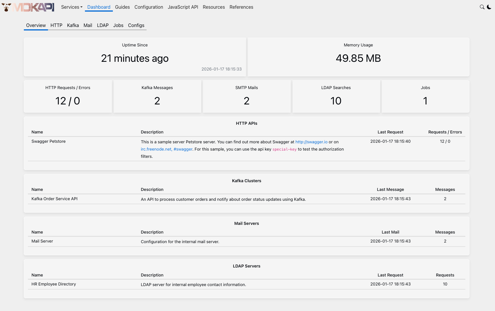
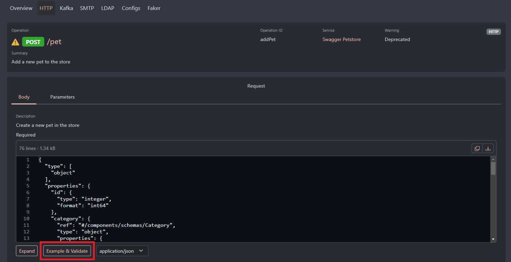
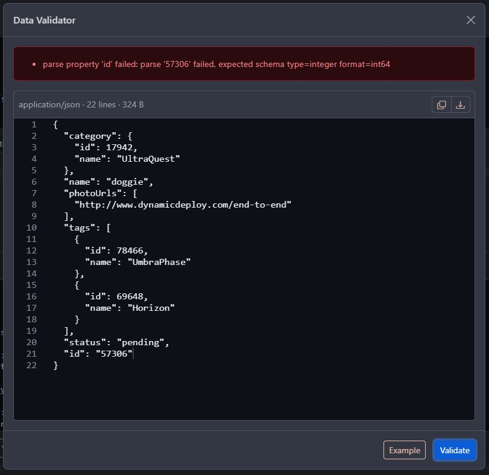

# Using Mokapi Dashboard

The dashboard provides graphical displays of your mock APIs and helps developers 
simulate real API responses during the development and testing phases. It allows 
you to validate data against the specification as well as generate new random, realistic and valid data.
This is useful during the early stages of development, facilitating rapid prototyping, testing error handling, 
and ensuring the mock APIs works seamlessly under various scenarios.

The dashboard is available on port 8080 by default. Open `http://localhost:8080` from your browser.



## Working with Dashboard

The dashboard displays key metrics like request logs, 
response times, and error rates, offering a comprehensive 
overview of how the mock API behaves under different conditions.

### Generate sample data from the specification

Some API types support generating sample data and validating data against the specification 
(namely HTTP and Kafka). Here is a quick overview with the HTTP example. To create sample data for a 
request body, navigate to an HTTP endpoint and look for the "Example & Validate" button.
In the opened dialog you can create, edit, validate, copy to the clipboard and download 
your sample data.



### Validate data

In the same dialog where we can create sample data, we can also validate it. The next image
shows an example of an HTTP REST request body that is not valid according to the specification.



## How to customize?

There are several options to customize the dashboard to fit your environment.

### How to change the default port?

You can change the default port on which the dashboard should run as follows:

```bash tab=CLI
--api-port 5000
```
```bash tab=Env
MOKAPI_API_PORT=5000
```
```yaml tab=File (YAML)
api:
  port: 5000
```

### Adding a Path Prefix

Many applications are not hosted in the root (/) of their domain. For example,  
Mokapi's Dashboard could live at `example.com/mokapi`. In this case, a prefix must be 
added to the dashboard, so a link to `/dashboard` should be rewritten as `/mokapi/dashboard`.

```bash tab=CLI
--api-path /mokapi
```
```bash tab=Env
MOKAPI_API_PATH=/mokapi/dashboard
```
```yaml tab=File (YAML)
api:
 path: /mokapi
```

### Behind a Reverse Proxy

If the dashboard is running behind a reverse proxy and the proxy strips segments from the request 
URL, you must set the base path. For example, the URL to the dashboard is `example.com/app/mokapi`
but the request URL to your host running the dashboard is `/`

```bash tab=CLI
--api-base /app/mokapi
```
```bash tab=Env
MOKAPI_API_BASE=/app/mokapi
```
```yaml tab=File (YAML)
api:
 base: /app/mokapi
```

Further configuration options are documented [here](/docs/configuration/reference.md).

## API

Mokapi exposes a set of information through an API handler, 
such as the configurations, logs and metrics. The API is available at the same port 
as the dashboard but on the path /api

### Endpoints

You can find the OpenAPI specification of these endpoints 
[here](https://github.com/marle3003/mokapi/blob/master/examples/mokapi/dashboard.yml)

| Path                              | Description                            |
|-----------------------------------|----------------------------------------|
| /api/info                         | get information about mokapi's runtime |
| /api/services                     | list of all services                   |
| /api/services/http/{name}         | Information about the http service     |
| /api/services/kafka/{name}        | Information about the kafka cluster    |
| /api/services/mail/{name}         | Information about the smtp server      |
| /api/services/kafka/{name}/groups | list of kafka groups                   |
| /api/events                       | list of events                         |
| /api/events/{id}                  | get event by id                        |
| /api/metrics                      | get list of metrics                    |
| /api/schema/example               | returns example for given schema       |
| /api/services/http/validate       | validate an HTTP request and response  |

### Validate a request and response

`POST /api/services/http/validate` checks an HTTP request and its response against the
OpenAPI contracts loaded in Mokapi. Use it to verify that the traffic of your application,
or the output of a test, matches the specification. The endpoint has no side effects: Mokapi
doesn't create an event or a metric and doesn't run any script.

```bash
curl -X POST http://localhost:8080/api/services/http/validate \
  -H "Content-Type: application/json" \
  -d '{
    "api": "Petstore",
    "request": {
      "method": "POST",
      "url": "/pet",
      "headers": { "Content-Type": "application/json" },
      "body": "{\"name\": \"Rex\"}"
    },
    "response": {
      "statusCode": 200,
      "headers": { "Content-Type": "application/json" },
      "body": "{\"id\": 1}"
    }
  }'
```

| Field                | Required | Description                                                             |
|----------------------|----------|-------------------------------------------------------------------------|
| api                  | no       | `info.title` of the OpenAPI specification. Without it, Mokapi searches all HTTP APIs. |
| request.method       | yes      | HTTP method, case-insensitive                                           |
| request.url          | yes      | Path and query string, for example `/pet/1?verbose=true`. An origin is ignored. |
| request.headers      | no       | Object with header names and string values                              |
| request.body         | no       | Request body as a string                                                |
| response.statusCode  | yes      | HTTP status code                                                        |
| response.headers     | no       | Object with header names and string values                              |
| response.body        | no       | Response body as a string                                               |

Header values and bodies are always strings. Mokapi converts header values to the type defined
in the specification, so the value `"5"` is valid for an integer header.

#### Result

If the request is well-formed, Mokapi answers with status `200`, even if the validation fails.

```json
{
  "valid": false,
  "operation": {
    "api": "Petstore",
    "method": "POST",
    "path": "/pet"
  },
  "errors": [
    {
      "location": "request.body",
      "schema": "#/required",
      "message": "required properties are missing: email"
    }
  ]
}
```

| Field     | Description                                                                          |
|-----------|--------------------------------------------------------------------------------------|
| valid     | `true` if `errors` is empty                                                          |
| operation | The matched operation: `api`, `method` in uppercase and `path` as written in the contract. Missing if no operation matches. |
| errors    | List of violations, an empty array if the request and response are valid             |

Each error has a `location`, a `message` and, for schema violations, a `schema` with the
JSON pointer to the failed schema keyword.

| Location                  | Checks                                              |
|---------------------------|-----------------------------------------------------|
| operation                 | No operation found, or several APIs match           |
| request.path.`<name>`     | Path parameter                                      |
| request.query.`<name>`    | Query parameter                                     |
| request.header.`<name>`   | Request header                                      |
| request.cookie.`<name>`   | Request cookie                                      |
| request.body              | Request body                                        |
| response.status           | No response defined for the status code             |
| response.header.`<name>`  | Response header                                     |
| response.body             | Response body                                       |

#### Finding the operation

Mokapi resolves the operation like it does for a mock request: a literal path wins over a
parameterized one, and the path of the `servers` URL is the base path of the API. The base
path is matched case-insensitively. A server URL with variables, such as
`https://{env}.example.com/v1`, is not supported and never matches.

If no operation matches, the result has `valid: false`, no `operation` and a single error with
the location `operation`. If operations in several APIs match, the error lists these APIs and
you set `api` to choose one.

#### What is checked

Request parameters and the request body are validated, and Mokapi reports all errors instead
of stopping at the first. Extra headers are allowed. Security requirements aren't checked.

For the response, Mokapi checks that the status code is defined, the response headers and the
body. Header names are case-insensitive. A `Content-Type` header defined in the specification is
ignored, as OpenAPI requires.

The content type of the body must be defined for the status code, whatever the type is. Only
JSON bodies (`application/json` and `+json` types) are validated against the schema. Bodies
of other types, such as XML or plain text, are not checked.

A `HEAD` operation must be defined as `head:` in the specification. Mokapi doesn't validate its
response body.

If the response has no `Content-Type` header, Mokapi works as follows:

- An empty body is valid if the status code defines no content, otherwise the error is
  `response body is required`.
- Otherwise Mokapi tries each media type defined for the status code. If none fits, the error is
  `no matching content type defined`. If the status code defines exactly one JSON media type,
  Mokapi reports the schema errors of that type instead.

#### Status codes

| Status | Description                                                                   |
|--------|-------------------------------------------------------------------------------|
| 200    | The request was validated. Check `valid` in the body.                         |
| 400    | Invalid JSON, a missing `request`, `response`, `request.method`, `request.url` or `response.statusCode`, or an unparseable `request.url` |
| 404    | The API in `api` doesn't exist                                                |
| 405    | The HTTP method is not `POST`                                                 |

Errors use the format `{ "message": "api 'Petstore' not found" }`.

#### CORS

The API allows requests from any origin, so a browser application on another origin, for
example Storybook, can call the endpoint. An `OPTIONS` request to any `/api/...` path
answers with `204` and these headers:

```
Access-Control-Allow-Origin: *
Access-Control-Allow-Methods: GET, POST
Access-Control-Allow-Headers: Content-Type
```
