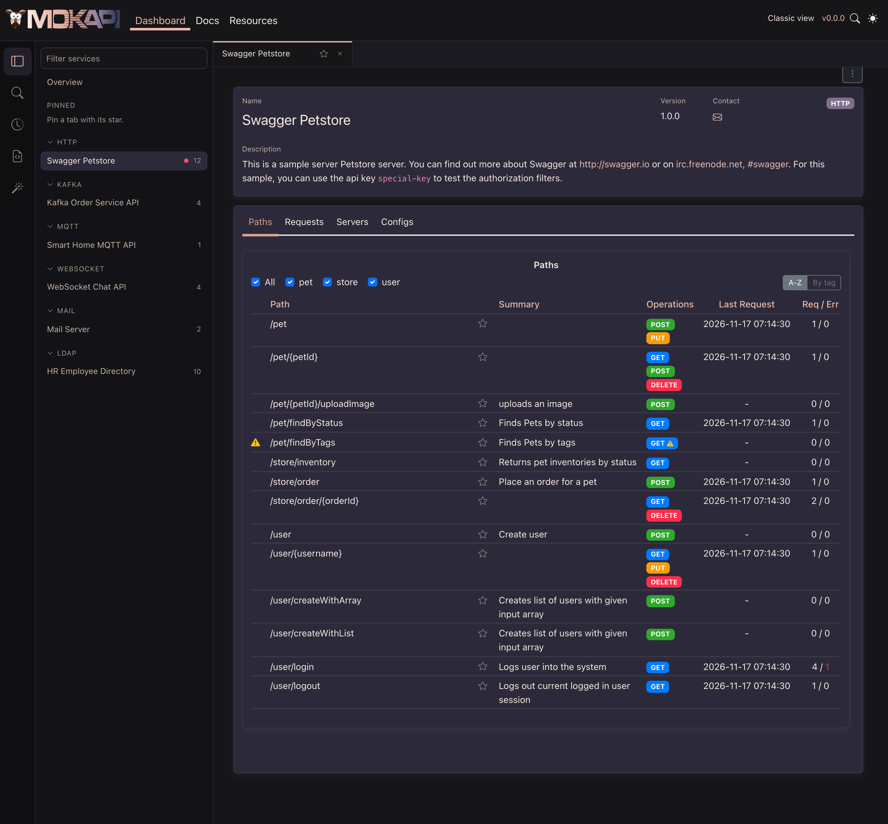
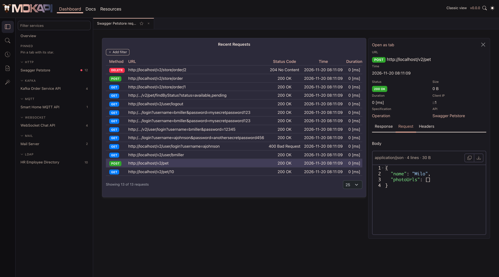

# Running Your First Mocked REST API with Mokapi

This guide starts Mokapi with the [Swagger Petstore](https://swagger.io/) specification and
sends a first request to the mock. If you haven't installed Mokapi yet, see the
[Installation Guide](/docs/get-started/installation.md).

## Mocking Petstore API

Start Mokapi with the Petstore OpenAPI specification directly from the web:

```bash
mokapi --providers-http-url https://raw.githubusercontent.com/marle3003/mokapi/main/examples/swagger/petstore-3.0.json
```

``` box=info
When you use Mokapi behind a corporate proxy, you probably need to skip TLS verification:
`--providers-http-tls-skip-verify`.
```

Mokapi serves the Petstore API on port 80 and the dashboard on port 8080. The mock API is
available under `/api/v3`, as defined in the OpenAPI specification. For more ways to start
Mokapi, see [Running Mokapi](/docs/configuration/running-mokapi.md). Every option can be set
as a flag, an environment variable or in a configuration file. The
[CLI Flags](/docs/configuration/static/cli-flags) page lists them all.

## Test Your Mock REST API

Send a request to the mock API:

```bash
curl --header "Accept: application/json" http://localhost/api/v3/pet/4
```

Mokapi generates a random response that matches the OpenAPI specification. The `Accept`
header makes sure you get JSON, because the Petstore also returns XML.

``` box=info
Without an Accept header, Mokapi picks one of the content types in the specification at
random, so you may get a format you didn't expect.
```

## Analyze API and HTTP Request/Response

Open `http://localhost:8080` in your browser. After opening the Petstore API in the dashboard,
you see all mocked endpoints with the number of requests and errors, including your request.



Click the request in the *Recent Requests* table to see the request and its response.



## Next Steps

- [HTTP Quick Start](/docs/http/quick-start.md): return your own data and errors with a Mokapi Script
- [Test Data](/docs/get-started/test-data.md)
- [Dashboard](/docs/get-started/dashboard.md)
- [Mocking HTTP API](/docs/http/overview.md)
