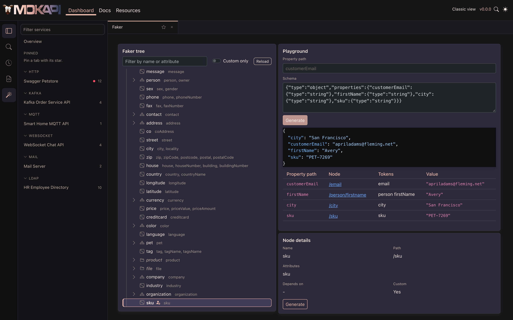

# Generate Realistic Test Data

Creating reliable test data is essential for accurate API testing and development.
Mokapi provides a powerful data generation engine that creates realistic test data
based on your API specifications.

You have multiple options for controlling generated data:

- **Automatic Generation**  
  Mokapi analyzes your schema and generates context-aware, realistic data automatically
- **Declarative Formats**  
  Use standard formats like `date`, `email`, `uuid` in your schema
- **JavaScript Customization**  
  Extend the generator with custom logic for specific fields or patterns
- **Full Response Control**
  Write complete response handlers with conditional logic and dynamic behavior

## Automatic Test Data Generation

By default, Mokapi analyzes your API's data structure and types to generate
meaningful responses. It also tailors responses based on request parameters,
ensuring relevant data is returned.

### Context-Aware Generation

For example, if a request filters for available pets, the response includes
only pets with `status: "available":

```bash tab=Single Pet
GET http://localhost/api/v3/pet/4
HTTP/1.1 200 OK
Content-Type: application/json
{
    "id": 4,
    "name": "Larry",
    "category": {
        "id": 1,
        "name":"dog"
    },
    "photoUrls": [ 
        "https://www.dynamicsyndicate.biz/reintermediate/models"
    ],
    "tags": [
        {
            "id": 46110,
            "name": "Lux"
        }
    ],
    "status": "pending"
}
```
```bash tab=Filtered List
GET http://localhost/api/v3/pet/findByStatus?status=available
HTTP/1.1 200 OK
Content-Type: application/json
[
    {
        "name": "Yoda",
        "photoUrls": [
            "http://www.internalbandwidth.com/b2c/magnetic/dot-com/collaborative"
        ],
        "status": "available"
    }
]
```

Notice how the status field in the second example matches the query parameter.
Mokapi understands the request context and generates appropriate data.

A request parameter is copied only into the properties with the same name at the shallowest
object level where such a property exists. For `GET /users/123` with a schema
`{ id, friends: [{ id }] }`, the root `id` is `123` and the `id` of each friend is generated
randomly. Query filters in a root array or in a wrapper such as `{ items: [...] }` still
apply to every item, because the items are the shallowest level that has the property.

## Declarative Formats in Schema

Use standard OpenAPI formats to generate specific data types automatically. 
Mokapi recognizes these formats and produces realistic values:

| Format        | Type     | Example Output                                            |
|---------------|----------|-----------------------------------------------------------|
| date          | string   | 2017-07-21                                                |
| time          | string   | 17:32:28Z                                                 |
| date-time     | string   | 2017-07-21T17:32:28Z                                      |
| email         | string   | shanellewehner@cruickshank.biz                            |
| uuid          | string   | dd5742d1-82ad-4d42-8960-cb21bd02f3e7                      |
| uri           | string   | http://www.regionale-enable.info/virtual/portals/redefine |
| password      | string   | w*YoR94jFL@X                                              |
| ipv4          | string   | 68.244.174.93                                             |
| {zip} {city}  | string   | 82910 San Jose                                            |

### Example Schema

```yaml
schema:
  type: object
  properties:
    date:
      type: string
      format: date # 2017-07-21
    time:
      type: string
      format: date-time # 2017-07-21T17:32:28Z
    email:
      type: string
      format: email # demetrisdach@yost.org
    guid:
      type: string
      format: uuid # dd5742d1-82ad-4d42-8960-cb21bd02f3e7
```

This declarative approach requires no JavaScript, just add the `format` field to your schema.

## Customize with JavaScript

For more control, extend Mokapi's data generator with JavaScript. This is useful
when you need values from a specific list, complex patterns, or custom logic.

### Example: Custom Enum Values

Generate random values from a predefined list:

```javascript
import { fake, findByName, ROOT_NAME } from 'mokapi/faker';

export default function() {
    const frequencyItems = ['never', 'daily', 'weekly', 'monthly', 'yearly'];
    const root = findByName(ROOT_NAME);
    root.children.unshift({
        name: 'Frequency',
        attributes: [ 'frequency' ],
        fake: () => {
            return frequencyItems[Math.floor(Math.random()*frequencyItems.length)]
        }
    });
};
```

Now any field named `frequency` will randomly return one of these values.

``` box=tip title="Best Practice: Use Enums in Spec"
It's recommended to define possible values using `enum` in your OpenAPI 
specification. This allows Mokapi to randomly select from the list automatically
and clearly documents all available options for API users. The JavaScript
approach shown here demonstrates Mokapi's flexibility for cases where
enum isn't suitable.
```

## Full Response Control with Scripts

For complete control over API behavior, use Mokapi Scripts to customize 
responses, simulate errors, add delays, or implement complex logic.

### Example: Dynamic Time API

Create an API that returns the current timestamp:

```javascript tab=time.js
import {on} from 'mokapi'

export default function() {
    on('http', function(request, response) {
        if (request.operationId === 'time') {
            response.data = new Date().toISOString()
            return true
        }
        return false
    })
}
```

```yaml tab=api.yaml
openapi: 3.0.0
info:
  title: Time API
  version: 0.1.0
servers:
  - url: /time
paths:
  /:
    get:
      summary: Get the current date and time,
      operationId: time
      responses:
        '200': 
          description: The current date and time
          content:
            application/json:
              schema: 
                type: string
                format: date-time
```

This script intercepts requests to the `time` operation and returns the current
timestamp instead of a static mock value.

## Validate in the Dashboard

Open the dashboard at `http://localhost:8080` and click Faker in the activity bar. The page
shows which node generates a value, so you can check that your own node is used before you call
the API. See [Using Mokapi Dashboard](/docs/get-started/dashboard.md#faker) for an overview.



### Find your node

The Faker tree starts with a root row. Click the chevron of a node to open or close its
children, and click the node to show its details: name, path, attributes, weight, dependencies
and whether it is custom. A folder icon marks a node that only groups its children and has no
fake function. A person icon marks a node that a script added or changed. You can also move
through the tree with the arrow keys: Up and Down select the previous and next node, Right and
Left open, close or step to the child or parent.

Type in the filter field to search by name or attribute. While a filter is active, the matches
are shown open. **Custom only** hides everything except the nodes that your scripts changed, for
example the `Frequency` node from the example above. The tree is loaded when you open the page.
Click **Reload** after a script has changed it.

### Test a value

The playground generates a value and explains how Mokapi got it. Enter a property path, a
schema, or both, and click **Generate**:

| Field         | Example                                    |
|---------------|--------------------------------------------|
| Property path | `customerEmail`                            |
| Schema        | `{"type": "string", "format": "email"}`    |

The property path is a dot-separated path such as `address.city`, the schema is JSON. Below the
value, the Matches table has one row for each generated value:

| Column        | Description                                                                          |
|---------------|--------------------------------------------------------------------------------------|
| Property path | The location of the value. `tags[]` is an array item, `*` a value of `additionalProperties`. |
| Node          | The path of the node that produced the value. Click it to show the node in the tree. |
| Tokens        | The words of the property name that Mokapi matched against the tree.                 |
| Value         | The generated value                                                                  |

For example, the property path `customerEmail` resolves to the node `/email` with the token
`email`.

Some rows show `-` as Node and a note such as "from enum". The value didn't come from a node but
from the schema: `enum`, `const`, `examples`, the context or `null`. If no node fits, the node is
`fakeBySchema`, the fallback that generates a value from the schema type and format alone. If
your node doesn't appear, check its `attributes` and the tokens of the row.

``` box=info
If a custom `fake` function calls `fake()` again, Mokapi doesn't break down the nested values.
The Matches table shows only the row of the outer node.
```

## What's Next?

Explore related topics to get more out of Mokapi's test data generation:

{{ card-grid key="cards" }}
