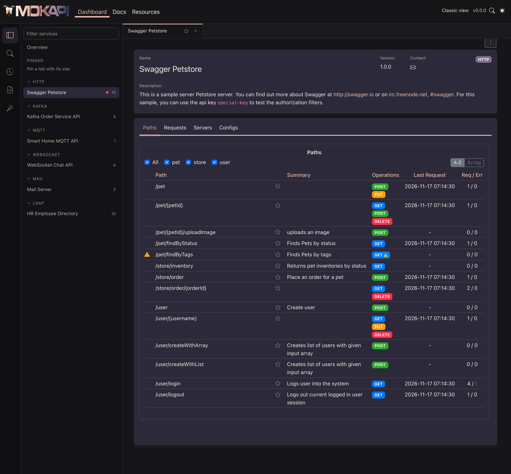
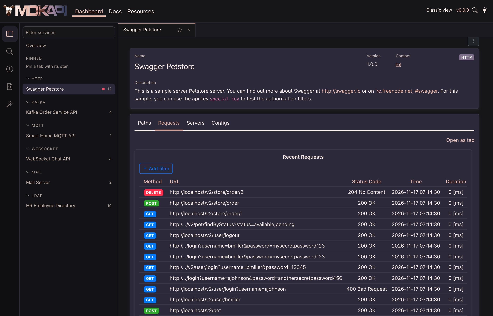
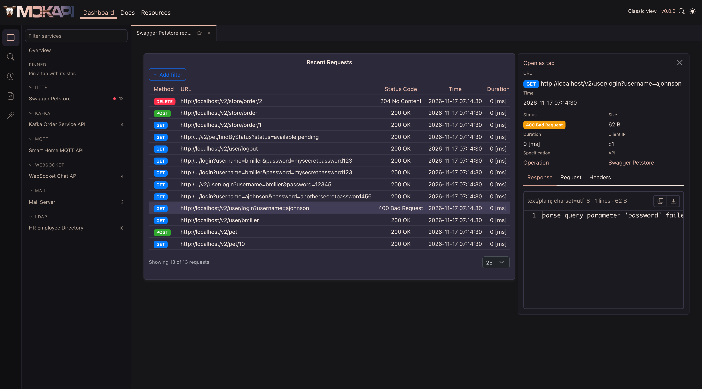
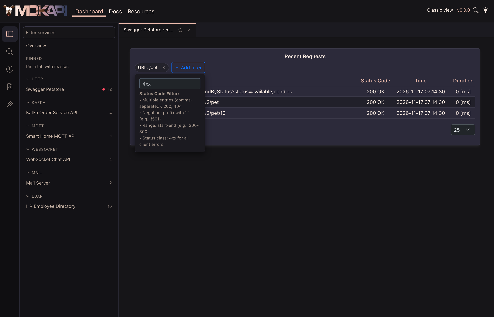
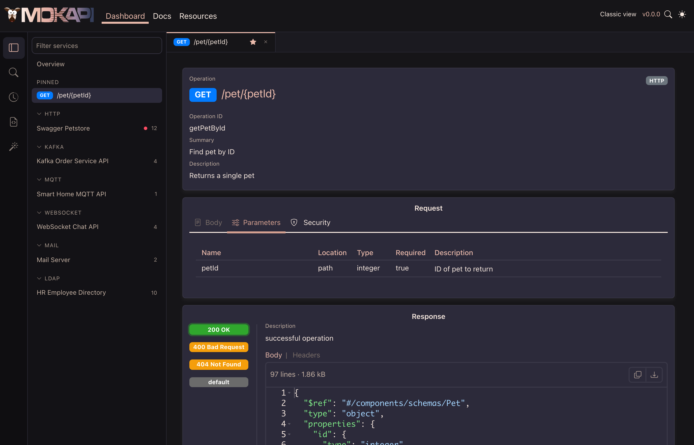

# Analyze your mocked HTTP API in Dashboard

Every HTTP API that Mokapi mocks gets its own view in the dashboard: its endpoints, the requests
Mokapi handled for it and the files it was loaded from.

## Overview of your mocked HTTP API

Mocked HTTP APIs are listed in the HTTP group of the sidebar, with their number of requests. A
red dot marks an API that handled requests with errors. Click the entry to open the view of the
API in a tab.

The top card shows the name, version, description and contact of the API. If the specification
has errors, a second card lists them. **Export** downloads the API as an OpenAPI specification or
as a [Bruno collection](/docs/http/export-bruno.md). Below, the view has four sub tabs:

| Sub tab  | Content                                                                          |
|----------|----------------------------------------------------------------------------------|
| Paths    | All paths with their operations, the time of the last request and the number of requests and errors |
| Requests | The log of the requests for this API, see [Request log](#request-log)            |
| Servers  | The server URLs from the specification, where the API is available              |
| Configs  | The files Mokapi loaded for this API, for example the specification and patches  |

Click the **HTTP** heading in the sidebar to open the HTTP page. It shows the
[metrics](#metrics), the list of all HTTP APIs and the log of all their requests.

The next image shows the Paths tab of a REST API. One path is deprecated and therefore marked with a
warning icon. The last columns show the time of the last request and the number of requests and errors.

## Metrics

In the new layout, the HTTP page starts with three tiles: **Requests**, **Errors** and
**Last Request**. **Errors** is red when it's greater than 0 and shows the error rate in percent
below the value, or `-` if there were no requests. **Last Request** shows the time of the latest
request as relative time (for example "2 minutes ago") with the absolute time below it, or `-` if
there was no activity yet.

The values cover all HTTP APIs, and a value that doesn't exist yet shows `0`. They update with
[auto refresh](/docs/get-started/dashboard.md#auto-refresh). The Classic view keeps the metric
cards.

## Endpoint view

Click a path in the **Paths** sub tab to open it, or one of its method badges to open the
operation directly. The path view shows the summary and description of the path and lists its
operations. The operation view shows:

- **Request** lists the parameters, the request body with its content types and the security
  schemes that apply to the operation (its own `security`, otherwise the global one).
- **Response** lists the status codes with their body and headers.
- Below, the log shows only the requests for this operation.

Request and response bodies have an **Example & Validate** button. It generates an example from
the schema and validates your own data, see
[Generate sample data](/docs/get-started/dashboard.md#generate-sample-data-from-the-specification).
A deprecated operation shows a warning.

## Request log

The request log lists the requests Mokapi handled for your API, newest first, with method, URL,
status code, time and duration. The log shows the requests that Mokapi still keeps in memory.

You find the log in these places:

- the **Requests** sub tab of an API view
- `/dashboard/http/log/:service`, the log of one API, for example `/dashboard/http/log/Petstore`
- `/dashboard/http/log`, the log of all HTTP APIs, which is also part of the HTTP page

The log of an endpoint or of a path shows only the requests for it.

In the Requests sub tab, click **Open as tab** to open the log of this API in its own dashboard
tab. A click replaces the active tab or activates the tab if it's already open. Ctrl+click,
Cmd+click or middle click opens a new tab. Click the star in the tab to pin the log, so it's
always in the **Pinned** section of the sidebar. The tab shows "Requests" for the log of all APIs and
"`<service>` requests" for one API.

### Request details

Click a row to open the details of the request next to the table. The selected row is
highlighted. The panel has three sub tabs:

| Sub tab  | Content                                                                          |
|----------|----------------------------------------------------------------------------------|
| Response | Status and body of the response. This is the default.                            |
| Request  | The parameters (except headers) and the body of the request                      |
| Headers  | The request headers and the response headers                                     |

Click **Open as tab** to show the request in the full view. A click replaces the active tab,
Ctrl+click or Cmd+click opens a new one. In the new layout, Ctrl+click, Cmd+click or middle click
on a row does the same without selecting the row. In the Classic view, only the URL link of a row
opens a browser tab this way.

Use the arrow keys up and down to select the previous or next request of the current page. Press
`Escape` or click **Close** to close the panel. The keys are ignored while you type in an input or
a dialog is open.

The selected request is part of the address (`?request=<id>`). After a reload, the panel opens
again, and you can copy the address to share the request with a colleague. Mokapi only keeps
a limited number of requests in memory. If Mokapi has dropped the request, the panel shows
"HTTP Request not found".

In windows narrower than 768 px, the panel is shown below the table.

### Filter requests

Active filters are shown as chips above the table. Click a chip to change its value in a popover,
click the x of a chip to remove the filter. **+ Add filter** lists the filters that aren't active yet:

| Field           | Description                                                                 |
|-----------------|-----------------------------------------------------------------------------|
| API Name        | Only in the log of all APIs. Select one or more APIs.                       |
| Method          | One or more HTTP methods                                                    |
| URL             | A regular expression matched against the request URL                        |
| Request Header  | Header name and value, both required. The value must match exactly.         |
| Status Code     | One or more status codes, see below                                         |
| Response Header | Header name and value, both required. The value must match exactly.         |
| Client IP       | One or more client addresses, see below                                     |

The Status Code field accepts:

| Syntax    | Meaning                          |
|-----------|----------------------------------|
| `200,404` | Several status codes             |
| `!501`    | Every status code except 501     |
| `200-300` | A range of status codes          |
| `4xx`     | A status class, here all client errors |

The Client IP field accepts a comma-separated list (`192.168.0.1,10.0.0.1`), a negation with `!`
(`!127.0.0.1`) and CIDR notation (`192.168.0.0/24`). The popover shows this help text next to
the field.

Mokapi saves the filters in the browser, separately for each API, path and method, and restores them
after a reload.

### Pause the log

While [auto refresh](/docs/get-started/dashboard.md#auto-refresh) is on, click **Pause** to stop
reloading the log, for example to read a request without new ones pushing it down the table.
Click **Resume** to reload it at once.

## Find and open endpoints

If you mock many APIs, use the filter at the top of the sidebar. It matches the API name, the
path of an endpoint, the HTTP method (for example `delete`) and the tag. Each API shows at most
6 matching endpoints, followed by "N more in `<API>`" which opens the API.

A click on an endpoint row replaces the active tab. Use Ctrl+click, Cmd+click or middle click
to open the endpoint in a new tab, for example to compare two endpoints. The tab title starts
with the HTTP method. Click the star in the row or in the tab to pin the endpoint, so it's
always one click away in the **Pinned** section of the sidebar.

### Group endpoints by tag

The endpoint list has a switch **A-Z** / **By tag**. By tag groups the endpoints under the tags
of your OpenAPI specification and shows the tag description next to the heading. Endpoints
without a tag are listed under "Untagged". Mokapi remembers the choice for each API.

See [Using Mokapi Dashboard](/docs/get-started/dashboard.md) for tabs, Pinned and the other
parts of the layout.
