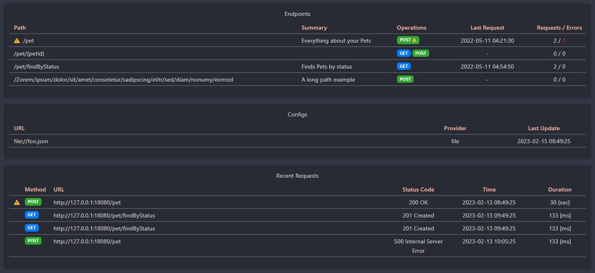

# Analyze your mocked HTTP API in Dashboard

The dashboard helps you analyze your mocked APIs, how they are used and what data is transferred.

## Overview of your mocked HTTP API

Mocked HTTP APIs are listed in the HTTP group of the sidebar, with their number of requests. A
red dot marks an API that handled requests with errors. Click the entry to open the detailed
view in a tab. In this detailed view you can see:
- a summary about this API
- server and base URLs where this API is available
- all API endpoints with the corresponding metrics.
- all configurations that affect this API
- the Requests tab with the log of recent HTTP requests (see [Request log](#request-log))

Click the **HTTP** heading to see the metrics and the log of all HTTP APIs.

In the next image you can see an example of a REST API showing four Paths one is deprecated
and therefore marked with a warning icon. In the Recent Requests log, you can see
four HTTP requests, one of which has a validation error that is counted in the Errors metric.

## Request log

The request log lists the requests Mokapi handled for your API, newest first, with method, URL,
status code, time and duration. The log shows the requests that Mokapi still keeps in memory.

You find the log in these places:

- the **Requests** sub tab of an API view
- `/dashboard/http/log/:service`, the log of one API, for example `/dashboard/http/log/Petstore`
- `/dashboard/http/log`, the log of all HTTP APIs, which is also part of the HTTP page

The log of an endpoint or of a path shows only the requests for it.

In the Requests sub tab, click **Open as tab** to open the log of this API in its own dashboard
tab. A click replaces the active tab or activates the tab if it's already open. Ctrl+click,
Cmd+click or middle click opens a new tab. Click the star in the tab to pin the log, so it's
always in the **Pinned** section of the sidebar. The tab shows "Requests" for the log of all APIs and
"`<service>` requests" for one API.

<!-- screenshot: Requests sub tab of an API with the log, the chips and the Open as tab link -->

### Request details

Click a row to open the details of the request next to the table. The selected row is
highlighted. The panel has three sub tabs:

| Sub tab  | Content                                                                          |
|----------|----------------------------------------------------------------------------------|
| Response | Status and body of the response. This is the default.                            |
| Request  | The parameters (except headers) and the body of the request                      |
| Headers  | The request headers and the response headers                                     |

Click **Open as tab** to show the request in the full view. A click replaces the active tab,
Ctrl+click or Cmd+click opens a new one. In the new layout, Ctrl+click, Cmd+click or middle click
on a row does the same without selecting the row. In the Classic view, only the URL link of a row
opens a browser tab this way.

Use the arrow keys up and down to select the previous or next request of the current page. Press
`Escape` or click **Close** to close the panel. The keys are ignored while you type in an input.

The selected request is part of the address (`?request=<id>`). After a reload, the panel opens
again, and you can copy the address to share the request with a colleague. Mokapi only keeps
a limited number of requests in memory. If Mokapi has dropped the request, the panel shows
"HTTP Request not found".

In windows narrower than 768 px, the panel is shown below the table.

<!-- screenshot: request log with the detail panel open on the Response sub tab -->

### Filter requests

Active filters are shown as chips above the table. Click a chip to change its value in a popover,
click the x of a chip to remove the filter. **+ Add filter** lists the filters that aren't active yet:

| Field           | Description                                                                 |
|-----------------|-----------------------------------------------------------------------------|
| API Name        | Only in the log of all APIs. Select one or more APIs.                       |
| Method          | One or more HTTP methods                                                    |
| URL             | A regular expression matched against the request URL                        |
| Request Header  | Header name and value, both required. The value must match exactly.         |
| Status Code     | One or more status codes, see below                                         |
| Response Header | Header name and value, both required. The value must match exactly.         |
| Client IP       | One or more client addresses, see below                                     |

The Status Code field accepts:

| Syntax    | Meaning                          |
|-----------|----------------------------------|
| `200,404` | Several status codes             |
| `!501`    | Every status code except 501     |
| `200-300` | A range of status codes          |
| `4xx`     | A status class, here all client errors |

The Client IP field accepts a comma-separated list (`192.168.0.1,10.0.0.1`), a negation with `!`
(`!127.0.0.1`) and CIDR notation (`192.168.0.0/24`). The popover shows this help text next to
the field.

Mokapi saves the filters in the browser, separately for each API, path and method, and restores them
after a reload.

<!-- screenshot: filter chips, an open popover for Status Code and the + Add filter menu -->

### Pause the log

While auto refresh is on, the log reloads by itself. Open the dashboard with `?refresh=<seconds>`,
for example `/dashboard?refresh=20`, to turn it on. Click **Pause** to stop reloading the log, for example to read a
request without new ones pushing it down the table. Without auto refresh, the log doesn't reload
by itself and **Pause** has no effect. The log shows "Paused" until you click
**Resume**, which reloads it at once. Pause only affects this log, other views keep updating.

Mokapi doesn't save the pause. A reload of the page or a switch to another tab runs the log
again. If you change a filter or the page while paused, the log loads the new result and runs
again. The demo dashboard has no Pause button, because it has no live requests.

## Find and open endpoints

If you mock many APIs, use the filter at the top of the sidebar. It matches the API name, the
path of an endpoint, the HTTP method (for example `delete`) and the tag. Each API shows at most
6 matching endpoints, followed by "N more in `<API>`" which opens the API.

A click on an endpoint row replaces the active tab. Use Ctrl+click, Cmd+click or middle click
to open the endpoint in a new tab, for example to compare two endpoints. The tab title starts
with the HTTP method. Click the star in the row or in the tab to pin the endpoint, so it's
always one click away in the **Pinned** section of the sidebar.

<!-- screenshot: HTTP endpoint tab with method badge, pinned star and the Pinned section in the sidebar -->

### Group endpoints by tag

The endpoint list has a switch **A-Z** / **By tag**. By tag groups the endpoints under the tags
of your OpenAPI specification and shows the tag description next to the heading. Endpoints
without a tag are listed under "Untagged". Mokapi remembers the choice for each API.

See [Using Mokapi Dashboard](/docs/get-started/dashboard.md) for tabs, Pinned and the other
parts of the layout.
