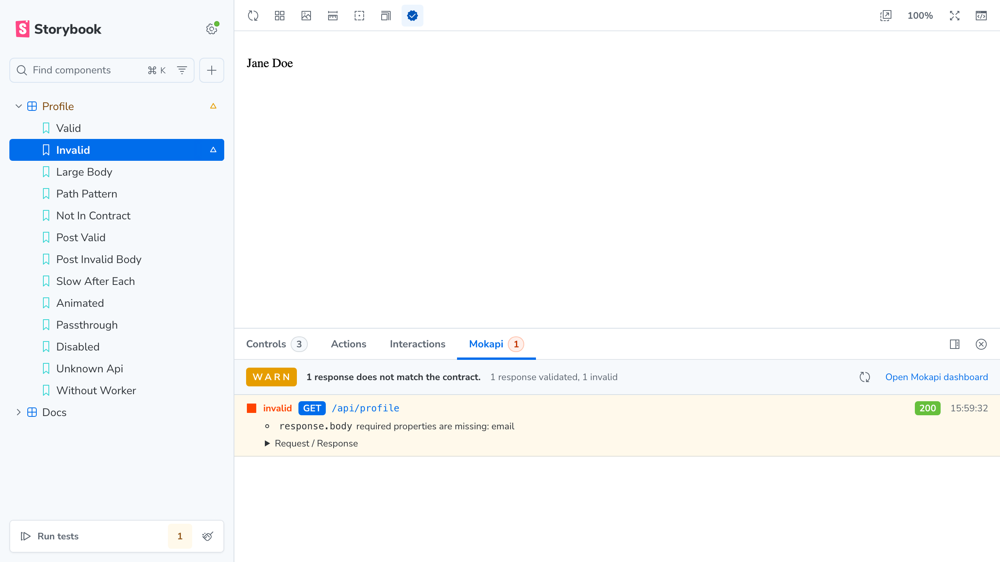

# Storybook Addon

Check your Storybook mocks against your OpenAPI contract with Mokapi.

Your stories already use [MSW](https://mswjs.io) handlers to mock API
responses. The addon sends each mocked request and response to Mokapi, which
validates the pair against your OpenAPI contract. You keep your MSW setup and see
in the story when a mock drifts from the API.

- **One toolbar toggle:** an icon button that turns validation on or off. Off sends nothing.
- **Your MSW setup stays yours:** nothing Mokapi-specific goes into `.storybook/preview.ts` or into your stories.
- **Panel with badge:** every validated response shows as valid, invalid or not in the contract, with Mokapi's error messages. The tab shows how many are invalid.
- **Failing stories:** optionally, a story fails when its responses don't match the contract, so CI catches contract drift. In Storybook the story gets an error or warning icon in the sidebar.
- **No change for the component:** it gets the MSW response unchanged and without delay.



## How it works

```
  Story renders, component calls fetch('/api/profile')
                      │
                      ▼
        MSW service worker answers with your handler
                      │ response:mocked event
                      ▼
          addon copies the request and response
                      │ POST <dashboardUrl>/api/services/http/validate
                      ▼
        Mokapi finds the operation in your OpenAPI
        contract and checks request and response
                      │
                      ▼
        Mokapi panel in Storybook: valid / invalid /
        not in contract, badge counts the invalid ones
```

The addon registers a `beforeEach` hook in its own preview annotations. Storybook
runs it after all loaders, so the MSW worker that your loader put in
`context.msw` already exists. The hook listens to the worker's `response:mocked`
event. It copies the request and the response, sends the copy to Mokapi and
shows the result in the panel. The addon never starts Mokapi or MSW and imports
nothing from `msw`.

Only responses from your handlers are validated. Requests that you pass through
with `passthrough()`, that no handler matches or that you answer with
`HttpResponse.error()` are not sent.

## Requirements

- [Mokapi](/docs/get-started/installation.md) 0.58.0 or newer (0.60.0 for [partial responses](/docs/integrations/storybook/usage.md#partial-responses))
- Storybook 10.6.7 or newer with the Vite builder and CSF3 stories
- MSW 2.15.0 or newer
- Node.js 22.12.0 or newer

## Quick start

This example assumes that your Storybook already uses MSW with
`msw-storybook-addon`. The full guide with five steps is in the
[README on GitHub](https://github.com/marle3003/mokapi-storybook-addon#quick-start).

Install the addon. Install Mokapi as well if you don't have it yet, for example
with `npm install --save-dev go-mokapi`.

```sh
npm install --save-dev mokapi-storybook-addon
```

Register it in `.storybook/main.ts`. Both options are optional. Without options,
the addon uses the Mokapi dashboard at `http://localhost:8080` and starts with
validation off.

```ts
// .storybook/main.ts
export default {
  framework: '@storybook/react-vite',
  addons: [
    {
      name: 'mokapi-storybook-addon',
      options: {
        dashboardUrl: 'http://localhost:8080', // default
        defaultValidation: false,              // default
      },
    },
  ],
};
```

Start Mokapi with your OpenAPI contract, then Storybook:

```sh
npx mokapi ./openapi.json
npx storybook dev
```

Open a story, click the **Validate with Mokapi** icon button in the toolbar to
switch validation on and open the **Mokapi** panel.

## Next steps

- [Usage](/docs/integrations/storybook/usage.md): the toggle, choosing the API, partial responses and the panel.
- [Failing Stories](/docs/integrations/storybook/failing-stories.md): let CI fail on contract drift.
- [Reference](/docs/integrations/storybook/reference.md): options, parameters, errors and limitations.
