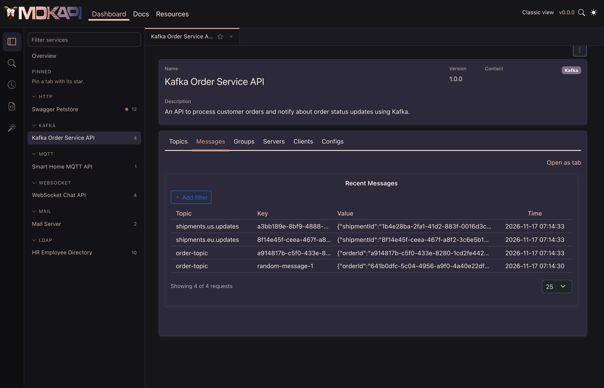
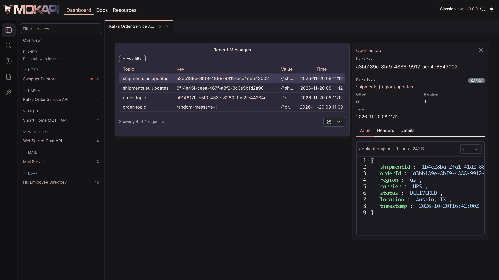
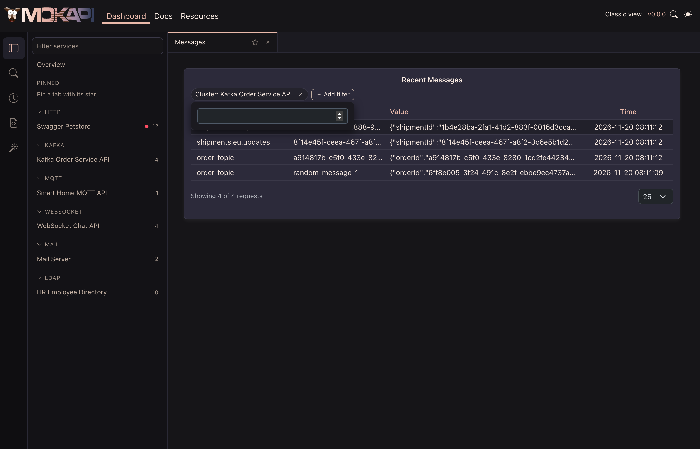
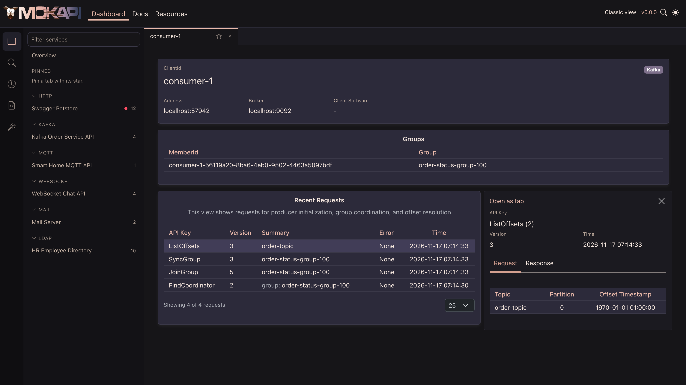

# Analyze your mocked Kafka API in Dashboard

Every Kafka cluster that Mokapi mocks gets its own view in the dashboard: its topics, consumer
groups, clients and the messages that were produced to it. Use it to check that a message arrived,
to read its key, value and headers and to find the messages of one topic, partition or client.

## Overview of your mocked Kafka cluster

Mocked Kafka clusters are listed in the Kafka group of the sidebar. Click the entry to open the
view of the cluster in a tab.

The top card shows the name, version, description and contact of the cluster. **Export** downloads
the cluster as an AsyncAPI specification. Select JSON or YAML, then click **Download** or copy the
URL, which has the form `/api/services/kafka/<cluster>/asyncapi.json`. Below, the view has six sub
tabs:

| Sub tab  | Content                                                                              |
|----------|--------------------------------------------------------------------------------------|
| Topics   | All topics with summary, time of the last message and number of messages. This is the default. |
| Messages | The log of the messages for this cluster, see [Message log](#message-log)            |
| Groups   | The consumer groups with state, protocol, generation, last rebalancing and members   |
| Servers  | The brokers from the specification with name, host, description and tags            |
| Clients  | The clients that connected, with client id, address and software                    |
| Configs  | The files Mokapi loaded for this cluster, for example the specification and patches  |

Click the **Kafka** heading in the sidebar to open the Kafka page. It shows the
[metrics](#metrics), the list of all clusters and the log of all their messages.

## Metrics

In the new layout, the Kafka page starts with three tiles: **Messages**, **Consumer Lag** and
**Last Message**. **Consumer Lag** is the sum of the lag of all consumer groups, topics and
partitions. **Last Message** shows the time of the latest message as relative time (for example
"2 minutes ago") with the absolute time below it, or `-` if there was no activity yet.

The values cover all Kafka clusters, and a value that doesn't exist yet shows `0`. They update with
[auto refresh](/docs/get-started/dashboard.md#auto-refresh). The Classic view keeps the metric
card.

## Topics, groups and clients

Click a topic in the Topics sub tab to open it. The topic view has these sub tabs:

| Sub tab    | Content                                                                         |
|------------|---------------------------------------------------------------------------------|
| Messages   | The log of the messages of this topic. This is the default.                     |
| Partitions | For each partition the ID, start offset, offset and number of segments          |
| Groups     | The consumer groups of this topic, including their lag                          |
| Configs    | The message definition from the specification, such as content type and schemas |

For a topic with a template name such as `shipments.{region}.updates`, the view lists the topics
Mokapi created from the template. Select one to see its messages. The Partitions and Groups tabs
exist only for a concrete topic.

If your topics have tags, the Topics sub tab has checkboxes to filter by tag and a switch **A-Z** /
**By tag**, which groups the topics under their tags, see
[Group by tag](/docs/get-started/dashboard.md#group-by-tag).

A group view shows state, protocol, generation and last rebalancing, the members with their
address, client software and last heartbeat (a star marks the group leader), and the committed
offset and lag for each topic partition. A member has its own view.

A client view shows the address, the broker it is connected to and the client software, the groups
the client is a member of, the [messages](#message-log) it produced and its
[requests](#client-request-log).

## Message log

The message log lists the messages of your topics, newest first, with topic, key, value and time.
The log shows the messages that Mokapi still keeps in memory.

You find the log in these places:

- the **Messages** sub tab of a Kafka cluster
- the **Messages** tab of a topic, which shows only the messages of this topic
- the view of a client, which shows only the messages this client produced. The log is hidden if
  the client has no messages and no filter is active.
- the Kafka page, which you open with the **Kafka** heading of the sidebar. It shows the log of
  all clusters.
- `/dashboard/kafka/log/<cluster>`, the log of one cluster, for example
  `/dashboard/kafka/log/Orders`
- `/dashboard/kafka/log`, the log of all Kafka clusters

In the Messages sub tab, click **Open as tab** to open the log of this cluster in its own dashboard
tab. A click replaces the active tab or activates the tab if it's already open. Ctrl+click,
Cmd+click or middle click opens a new tab. Click the star in the tab to pin the log, so it's
always in the **Pinned** section of the sidebar. The tab shows "Messages" for the log of all
clusters and "`<cluster>` messages" for one cluster.

Selecting tags in the Topics sub tab filters the topic table, not the message log.

### Message details

Click a row to open the details of the message next to the table. The selected row is
highlighted. The top of the panel shows the key, the topic (a link to the topic), the offset, the
partition and the time. Below it, the panel has three sub tabs:

| Sub tab | Content                                                                                      |
|---------|----------------------------------------------------------------------------------------------|
| Value   | The value of the message. This is the default.                                               |
| Headers | The headers of the message                                                                   |
| Details | Key type, client, content type and, if set, producer id, epoch and sequence number. Also the event handlers that ran for the message |

Click **Open as tab** to show the message in the full view. A click replaces the active tab,
Ctrl+click or Cmd+click opens a new one. In the new layout, Ctrl+click, Cmd+click or middle click
on a row does the same without selecting the row. In the Classic view, only the link in a row
(the topic or the key) opens a browser tab this way.

Use the arrow keys up and down to select the previous or next message of the current page. Press
`Escape` or click **Close** to close the panel. The keys are ignored while you type in an input or
a dialog is open.

The selected message is part of the address (`?message=<id>`). After a reload, the panel opens
again, and you can copy the address to share the message with a colleague. Mokapi only keeps
a limited number of messages in memory. If Mokapi has dropped the message, the panel shows
"Kafka Message not found".

In windows narrower than 768 px, the panel is shown below the table.

### Filter messages

Active filters are shown as chips above the table. Click a chip to change its value in a popover,
click the x of a chip to remove the filter. **+ Add filter** lists the filters that aren't active
yet:

| Field     | Description                                                     |
|-----------|-----------------------------------------------------------------|
| Cluster   | Only in the log of all clusters. Select one cluster.            |
| Topic     | The name of a topic. The input suggests the known topics.       |
| Partition | The number of a partition                                       |
| Client    | The client id of the producer                                   |

Each filter takes a single value. A view doesn't offer the fields it already fixes: the log of a
cluster has no Cluster filter, the topic view has no Topic filter and the client view has no Client
filter.

Two cases to keep in mind:

- The Client filter doesn't match messages that a script produced without a client, for example
  with `produce()` from `mokapi/kafka`, because those messages have no client id.
- For a topic with a template name such as `shipments.{region}.updates`, the Topic filter takes the
  template name and matches the messages of all its instances.

Mokapi saves the filters in the browser, separately for the log of all clusters, for each
cluster, for each topic (and instance of a template topic) and for each client. It restores them
after a reload.

### Pause the log

While [auto refresh](/docs/get-started/dashboard.md#auto-refresh) is on, click **Pause** to stop
reloading the log, for example to read a message without new ones pushing it down the table.
Click **Resume** to reload it at once. New messages appear on top while the log runs,
and the selected message stays selected.

## Client request log

The view of a Kafka client also lists the requests of this client in the "Recent Requests" table,
newest first, with API key, version, a summary, the error and the time. The table shows the
requests for producer initialization, group coordination and offset resolution. Each row opens in
a detail panel, in the same way as a message.

### Request details

Click a row to open the details of the request next to the table. The top of the panel shows the
API key with its number, the version and the time. Below it, the panel has the sub tabs
**Request** (the default) and **Response**. The sub tab stays the same when you select the next
request.

Click **Open as tab** to show the request in the full view. A click replaces the active tab,
Ctrl+click, Cmd+click or middle click opens a new one. In the new layout, Ctrl+click, Cmd+click or
middle click on a row does the same without selecting the row. Arrow keys up and down and `Escape`
work as in the [message details](#message-details).

The selected request is part of the address (`?request=<id>`). After a reload, the panel opens
again, and you can copy the address to share the request. If Mokapi has dropped the request, the
panel shows "Kafka Request not found".

A client view has one selection. Selecting a request closes the message panel and selecting a
message closes the request panel. **Pause** and **Resume** work as described in
[Pause the log](#pause-the-log) and also apply to the request log.

See [Using Mokapi Dashboard](/docs/get-started/dashboard.md) for tabs, Pinned and the other
parts of the layout.
