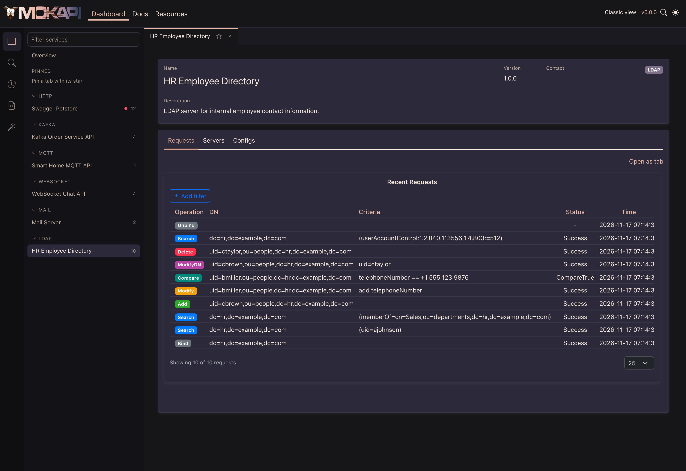
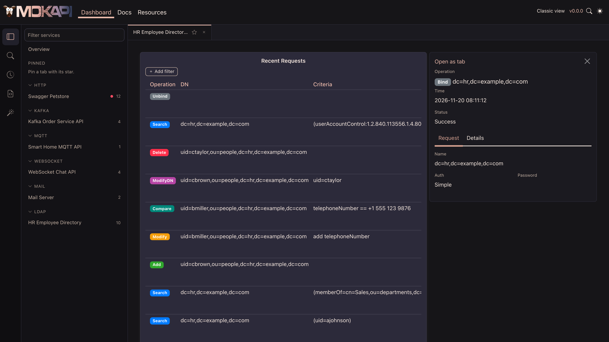
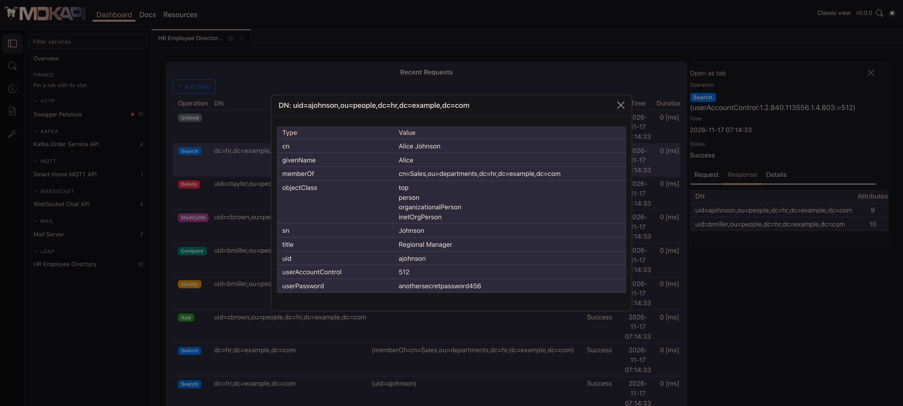
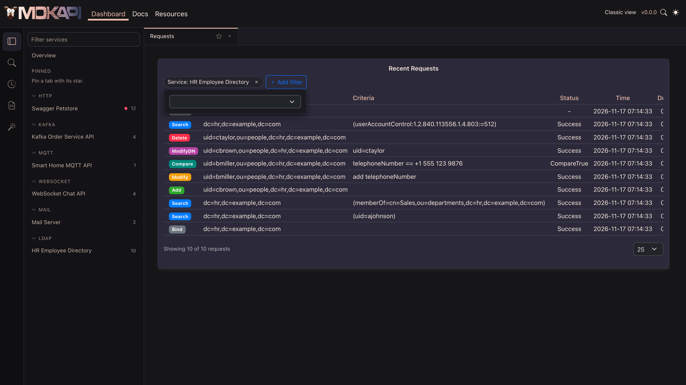

# Analyze your mocked LDAP API in Dashboard

The dashboard shows the requests that clients sent to your mocked LDAP directory, with operation,
DN, status and duration. Use it to check that a bind or search arrived, to read its parameters and
the result, and to find the requests of one service or one operation.

## Overview of your mocked LDAP directory

Mocked LDAP services are listed in the LDAP group of the sidebar, with their number of requests.
Click a service to open its view in a tab. The top card shows the name, version, description and
contact of the service. Below, the view has three sub tabs:

| Sub tab  | Content                                                                          |
|----------|----------------------------------------------------------------------------------|
| Requests | The log of the requests for this service, see [Request log](#request-log). Default. |
| Servers  | The address of the LDAP server                                                   |
| Configs  | The files Mokapi loaded for this service                                         |

Click the **LDAP** heading in the sidebar to open the LDAP page. It shows the [metrics](#metrics),
the list of all LDAP services with the time of their last request and their number of requests,
and the log of all their requests.

## Metrics

In the new layout, the LDAP page starts with three tiles: **Requests**, **Search Errors** and
**Last Request**. **Search Errors** counts the searches that ended with a result code other than
`success`, for example an invalid filter, the server size limit or a code set by a script.
**Last Request** shows the time of the latest request as relative time (for example
"2 minutes ago") with the absolute time below it, or `-` if there was no activity yet.

The values cover all LDAP services, and a value that doesn't exist yet shows `0`. They update with
[auto refresh](/docs/get-started/dashboard.md#auto-refresh). The Classic view keeps the metric
card.

## Request log

The request log lists the requests of your LDAP services, newest first, with operation, DN,
criteria, status, time and duration. The log shows the requests that Mokapi still keeps in memory.

You find the log in these places:

- the **Requests** sub tab of an LDAP service
- the LDAP page, which you open with the **LDAP** heading of the sidebar. It shows the log of all
  services.
- `/dashboard/ldap/log/<service>`, the log of one service, for example
  `/dashboard/ldap/log/HR Employee Directory`
- `/dashboard/ldap/log`, the log of all LDAP services

In the Requests sub tab, click **Open as tab** to open the log of this service in its own dashboard
tab. A click replaces the active tab or activates the tab if it's already open. Ctrl+click,
Cmd+click or middle click opens a new tab. Click the star in the tab to pin the log, so it's
always in the **Pinned** section of the sidebar. The tab shows "Requests" for the log of all
services and "`<service>` requests" for one service.

In the Classic view, the log has the same panel, filters and **Pause** button. Only the link in a
row opens a browser tab with Ctrl+click, Cmd+click or middle click.

### Request details

Click a row to open the details of the request next to the table. The selected row is
highlighted. The top of the panel shows:

- the operation, as a badge, followed by the filter of a Search, the name of a Bind or the DN of
  the other operations. An Unbind has no text.
- the status of the response
- the time

Below the head, the panel has these sub tabs:

| Sub tab  | Content                                                                                      |
|----------|----------------------------------------------------------------------------------------------|
| Request  | The fields of the request. This is the default. Not shown for Unbind and Delete.              |
| Response | The results of a Search. Only shown for Search.                                               |
| Details  | The duration, and the event handlers that ran for the request.                                |

The sub tab stays the same when you select the next request, as long as the next request has it.
Otherwise the panel shows the first sub tab.

In the Response sub tab, click a result to open a dialog with its attributes.

If the response of a failed request has a message or a matched DN, the Details sub tab shows them
as **Message** and **Matched DN**. Requests without them, and an Unbind, which has no response,
show neither field. The Event Handlers section only appears if a handler ran for the request.

Click **Open as tab** to show the request in the full view. A click replaces the active tab,
Ctrl+click or Cmd+click opens a new one. In the new layout, Ctrl+click, Cmd+click or middle click
on a row does the same without selecting the row. In the Classic view, only the link in a row
opens a browser tab this way.

Use the arrow keys up and down to select the previous or next request of the current page. Press
`Escape` or click **Close** to close the panel. The keys are ignored while you type in an
input or a dialog is open.

The selected request is part of the address (`?request=<id>`). After a reload, the panel opens
again, and you can copy the address to share the request with a colleague. Mokapi only keeps
a limited number of requests in memory. If Mokapi has dropped the request, the panel shows
"LDAP Request not found".

In windows narrower than 768 px, the panel is shown below the table.

### Filter requests

Active filters are shown as chips above the table. Click a chip to change its value in a popover,
click the x of a chip to remove the filter. **+ Add filter** lists the filters that aren't
active yet:

| Field     | Description                                                                                  |
|-----------|----------------------------------------------------------------------------------------------|
| Service   | Only in the log of all services. Select one service.                                         |
| Operation | Bind, Unbind, Search, Add, Modify, Delete, ModifyDN or Compare                               |

Each filter takes a single value. The log of a service doesn't offer the Service filter, because
it already fixes it.

Mokapi saves the filters in the browser, separately for the log of all services and for each
service. It restores them after a reload.

### Pause the log

While [auto refresh](/docs/get-started/dashboard.md#auto-refresh) is on, click **Pause** to stop
reloading the log, for example to read a request without new ones pushing it down the table.
Click **Resume** to reload it at once. New requests appear on top while the log runs,
and the selected request stays selected.

See [Using Mokapi Dashboard](/docs/get-started/dashboard.md) for tabs, Pinned and the other
parts of the layout.
