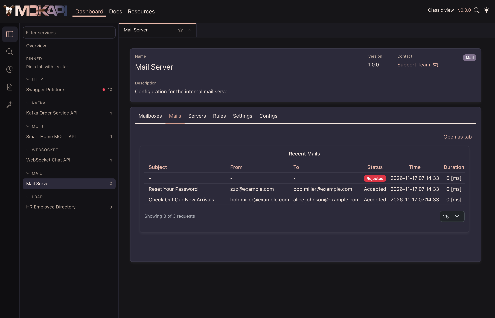
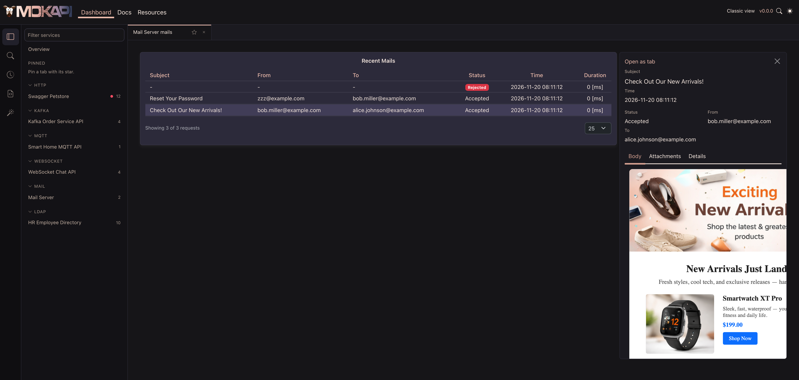
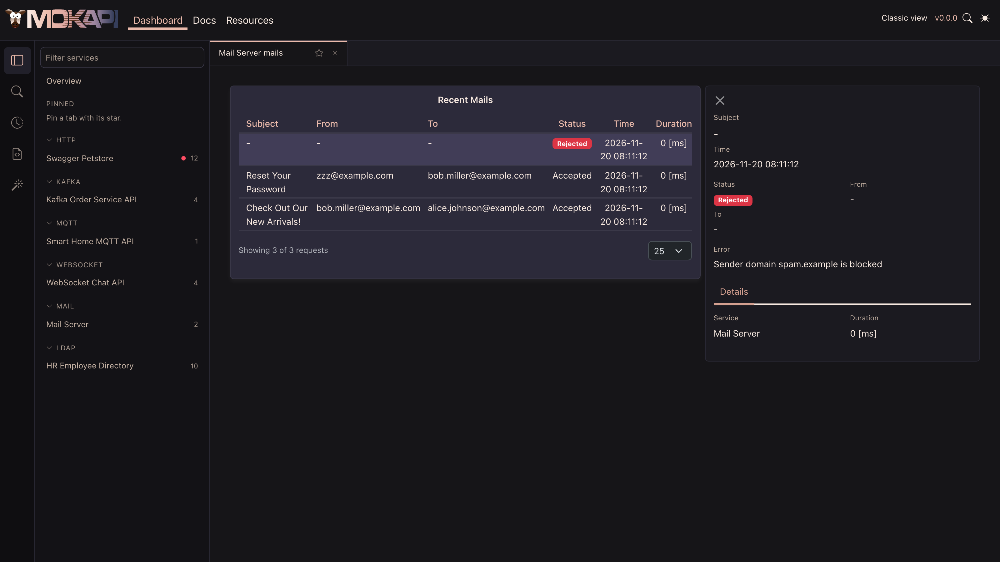
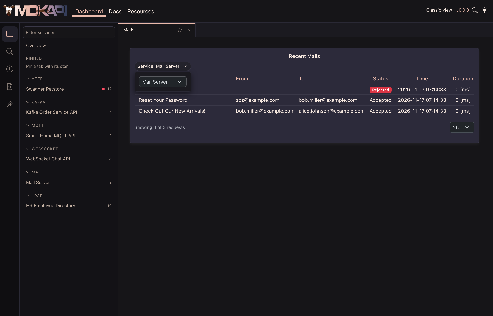

# Analyze your mocked Mail API in Dashboard

The dashboard shows the mails that clients sent to your mocked SMTP server, with subject, sender,
recipients, status and duration. Use it to check that a mail arrived, to read its body and
attachments, and to find out why a mail was rejected.

## Overview of your mocked mail service

Mocked mail services are listed in the Mail group of the sidebar, with their number of mails. Click
the entry to open the view of the service in a tab.

The top card shows the name, version, description and contact of the service. Below, the view has
these sub tabs:

| Sub tab   | Content                                                                              |
|-----------|--------------------------------------------------------------------------------------|
| Mailboxes | The mailboxes with username, password, description and number of mails. Default. |
| Mails     | The log of the mails for this service, see [Mail log](#mail-log)                     |
| Servers   | Name, host, protocol and description of the servers of the service                   |
| Rules     | The [rules](/docs/mail/rules.md) of the service. Only shown if the service has rules. |
| Settings  | The settings of the service                                                          |
| Configs   | The files Mokapi loaded for this service                                             |

Click the **Mail** heading in the sidebar to open the Mail page. It shows the [metrics](#metrics),
the list of all mail services (name, description, last mail and number of messages) and the log of
all their mails.

## Metrics

In the new layout, the Mail page starts with three tiles: **Mails**, **Mailboxes** and
**Last Mail**. **Mailboxes** is the number of mailboxes. **Last Mail** shows the time of the latest
mail as relative time (for example "2 minutes ago") with the absolute time below it, or `-` if
there was no activity yet.

The values cover all mail services, and a value that doesn't exist yet shows `0`. They update with
[auto refresh](/docs/get-started/dashboard.md#auto-refresh). The Classic view keeps the metric
card.

## Mailbox view

Click a mailbox in the **Mailboxes** sub tab to open it. The view shows the name, username,
password and description of the mailbox, its folders and its mails with subject, From, To and
date. If the mailbox doesn't exist, the view shows "Mailbox `<name>` not found".

Click a mail to open it in the [mail view](#mail-view). The mails of a mailbox don't include
rejected mails, and the mailbox view has no detail panel.

## Mail view

The mail view shows the subject, the service, the date and the addresses (From, To, Cc and Bcc) of
a mail, followed by its body, its attachments (if it has any) and technical details: content type,
encoding, Message-ID and In-Reply-To. A click on the In-Reply-To value opens that mail.

A mail with an HTML body is rendered as HTML. Use the sun or moon icon at the top right of the body
to switch between a light and a dark background. Mokapi remembers your choice in the browser. Click
an attachment to download it. If Mokapi doesn't have the mail, the view shows "Mail not found".

## Mail log

The mail log lists the mails of your mail services, newest first, with subject, From, To, status,
time and duration. The log shows the mails that Mokapi still keeps in memory. It is always shown,
also when it's empty. The count of a service in the sidebar and the **Mails** tile don't include
rejected mails.

You find the log in these places:

- the **Mails** sub tab of a mail service. The sub tabs of a service are **Mailboxes** (the
  default), **Mails**, **Servers**, **Rules** (only if the service has rules), **Settings** and
  **Configs**.
- the Mail page, which you open with the **Mail** heading of the sidebar. It shows the log of all
  services.
- `/dashboard/mail/log/<service>`, the log of one service, for example
  `/dashboard/mail/log/Mail Server`
- `/dashboard/mail/log`, the log of all mail services

In the Mails sub tab, click **Open as tab** to open the log of this service in its own dashboard
tab. A click replaces the active tab or activates the tab if it's already open. Ctrl+click,
Cmd+click or middle click opens a new tab. Click the star in the tab to pin the log, so it's
always in the **Pinned** section of the sidebar. The tab shows "Mails" for the log of all
services and "`<service>` mails" for one service.

In the Classic view, the log has the same panel, filters and **Pause** button. Only the link in a
row opens a browser tab with Ctrl+click, Cmd+click or middle click.

### Rejected mails

The log also lists mails that the server rejected, for example an unknown mailbox, too many
recipients, a failed authentication or a rule. The Status column shows **Accepted** or a red
**Rejected** badge. Hover over **Rejected** to read the error message. A mail counts as rejected
when its event has an error.

A rejected mail often has no subject, and sometimes no sender or recipients, because the server
rejected it before it received them. The table shows `-` for a missing value. A rejected mail has
no link in the Subject column, because there is no mail to open. A click on its row only selects it.

A [rule](/docs/mail/rules.md) that rejects a mail after the server received its content (in the
DATA command) shows two rows. The first row reads **Accepted** and has the subject, but its panel
says "Mail content is no longer available", because Mokapi never stores the mail. The second row
reads **Rejected** and shows the error.

A rule on the sender or a recipient rejects the mail earlier, in the MAIL FROM or RCPT TO command,
before the server receives the content. That gives a single **Rejected** row without a subject.

### Mail details

Click a row to open the details of the mail next to the table. The selected row is highlighted.
The top of the panel shows:

- the subject
- the status, as a badge
- From and To
- the time
- the error, for a rejected mail

Below the head, the panel has these sub tabs:

| Sub tab     | Content                                                                                       |
|-------------|-----------------------------------------------------------------------------------------------|
| Body        | The body of the mail. This is the default.                                                    |
| Attachments | The attachments of the mail. Only shown if the mail has attachments.                          |
| Details     | Service, duration, Cc, Bcc, content type, encoding, Message-ID and In-Reply-To.               |

The Details sub tab also lists the **Event Handlers** that ran for the mail, if there were any.

A rejected mail has only the Details sub tab, with the service and the duration. The sub tab stays
the same when you select the next mail, as long as the next mail has it. Otherwise the panel shows
the first sub tab.

Mokapi keeps the mails in the mailbox store, which can be smaller than the log. If a mail is no
longer in the store, for example because it was deleted, the head and the Details sub tab still
show what the event knows. The Body sub tab shows "Mail content is no longer available".

Click **Open as tab** to show the mail in the full view. A click replaces the active tab,
Ctrl+click or Cmd+click opens a new one. In the new layout, Ctrl+click, Cmd+click or middle click
on an accepted row does the same without selecting the row. A rejected mail has no **Open as tab**
link. In the Classic view, only the link in a row opens a browser tab this way. The full view
doesn't show the event handlers.

Use the arrow keys up and down to select the previous or next mail of the current page. Press
`Escape` or click **Close** to close the panel. The keys are ignored while you type in an input or
a dialog is open.

The selected mail is part of the address (`?message=<id>`). After a reload, the panel opens
again, and you can copy the address to share the mail with a colleague. Mokapi only keeps
a limited number of events in memory. If Mokapi has dropped the event, the panel shows
"Mail not found".

In windows narrower than 768 px, the panel is shown below the table.

### Filter mails

Active filters are shown as chips above the table. Click a chip to change its value in a popover,
click the x of a chip to remove the filter. **+ Add filter** lists the filters
that aren't active yet:

| Field   | Description                                          |
|---------|------------------------------------------------------|
| Service | Only in the log of all services. Select one service. |

The filter takes a single value. The log of a service doesn't offer the Service filter, because
it already fixes it. Subject, From, To and status aren't available as filters.

Mokapi saves the filter in the browser, separately for the log of all services and for each
service. It restores it after a reload.

### Pause the log

While [auto refresh](/docs/get-started/dashboard.md#auto-refresh) is on, click **Pause** to stop
reloading the log, for example to read a mail without new ones pushing it down the table.
Click **Resume** to reload it at once. New mails appear on top while the log runs,
and the selected mail stays selected.

See [Using Mokapi Dashboard](/docs/get-started/dashboard.md) for tabs, Pinned and the other
parts of the layout.
