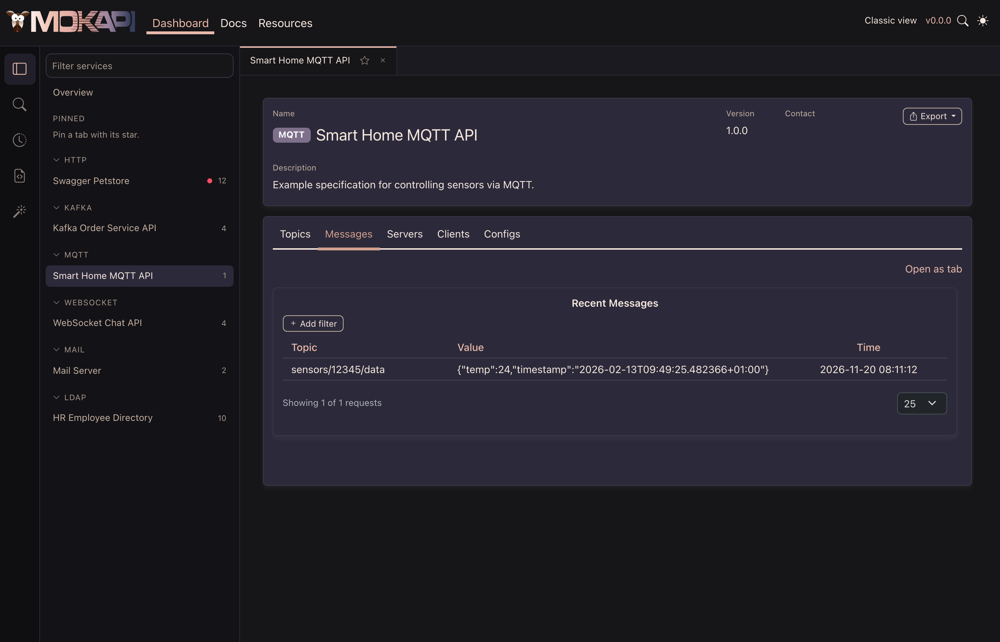
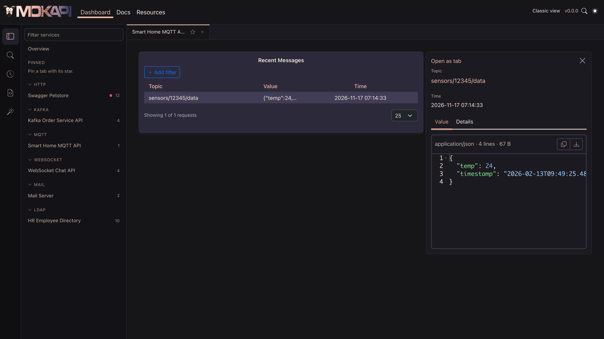
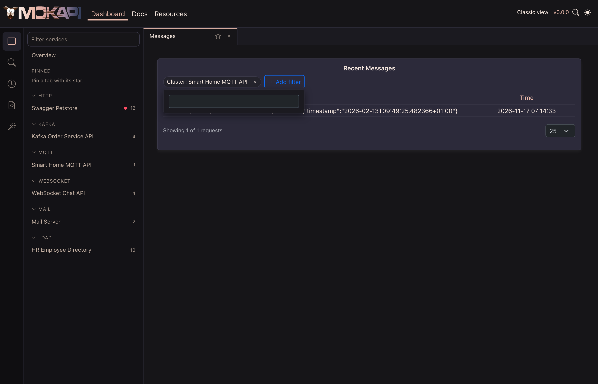
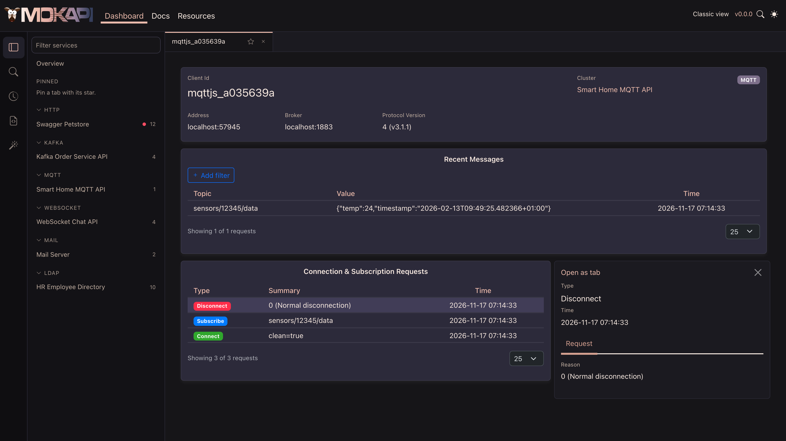

# Analyze your mocked MQTT API in Dashboard

Every MQTT cluster that Mokapi mocks gets its own view in the dashboard: its topics, the messages
published to them, the connected clients and the files it was loaded from.

## Overview of your mocked MQTT cluster

Mocked MQTT clusters are listed in the MQTT group of the sidebar. Click the entry to open the view
of the cluster in a tab.

The top card shows the name, version, description and contact of the cluster. **Export** opens a
dialog to download the cluster as an AsyncAPI specification in JSON or YAML, or to copy its URL.
Below, the view has five sub tabs:

| Sub tab  | Content                                                                              |
|----------|--------------------------------------------------------------------------------------|
| Topics   | All topics with summary, time of the last message and number of messages. This is the default. |
| Messages | The log of the messages for this cluster, see [Message log](#message-log)            |
| Servers  | The servers from the specification, with host, description and tags                  |
| Clients  | The clients that connected, with client id, address and protocol version             |
| Configs  | The files Mokapi loaded for this cluster, for example the specification and patches  |

Click the **MQTT** heading in the sidebar to open the MQTT page. It shows the [metrics](#metrics),
the list of all MQTT clusters and the message log of all of them.

## Metrics

In the new layout, the MQTT page starts with three tiles: **Messages**, **Topics** and
**Last Message**. **Topics** is the number of topics. **Last Message** shows the time of the latest
message as relative time (for example "2 minutes ago") with the absolute time below it, or `-` if
there was no activity yet.

The values cover all MQTT clusters, and a value that doesn't exist yet shows `0`. They update with
[auto refresh](/docs/get-started/dashboard.md#auto-refresh). The Classic view keeps the metric
card.

## Topics and clients

Click a topic in the **Topics** sub tab to open it. A topic with a template name such as
`sensors/{sensorId}/data` also lists its instances, the topics that received messages. The topic
view has two sub tabs: **Messages** shows the message log of this topic, **Config** shows the
message definition from the specification (name, title, summary, content type and the schema of
key and value). Selecting tags in the Topics sub tab filters the topic table. The switch
**A-Z** / **By tag** groups the topics, see
[Group by tag](/docs/get-started/dashboard.md#group-by-tag).

Click a client in the **Clients** sub tab to open it. The client view shows the client id,
cluster, address, broker address and protocol version, followed by the messages the client
published and its [requests](#client-request-log). If the client is gone, the view shows
"MQTT client `<id>` not found".

## Message log

The message log ("Recent Messages") lists the messages of your topics, newest first, with topic,
value and time. The log shows the messages that Mokapi still keeps in memory.

You find the log in these places:

- the **Messages** sub tab of an MQTT cluster
- the **Messages** sub tab of a topic, which shows only the messages of this topic
- the view of a client, which shows only the messages this client published. The log is hidden if
  the client has no messages and no filter is active.
- the MQTT page, which shows the log of all clusters
- `/dashboard/mqtt/log/<cluster>`, the log of one cluster, for example
  `/dashboard/mqtt/log/Sensor Service`
- `/dashboard/mqtt/log`, the log of all MQTT clusters

In the Messages sub tab, click **Open as tab** to open the log of this cluster in its own
dashboard tab. A click replaces the active tab or activates the tab if it's already open.
Ctrl+click, Cmd+click or middle click opens a new tab. Click the star in the tab to pin the log, so it's
always in the **Pinned** section of the sidebar. The tab shows "Messages" for the log of all
clusters and "`<cluster>` messages" for one cluster.

The Topics sub tab lists the topics only. Selecting tags there filters the topic table, not the
message log.

### Message details

Click a row to open the details of the message next to the table. The selected row is
highlighted. The top of the panel shows the topic (a link to the topic) and the time. Messages
that were published with the retain flag also show a **Retained** badge. Below it, the panel has
two sub tabs:

| Sub tab | Content                                                                      |
|---------|------------------------------------------------------------------------------|
| Value   | The value of the message. This is the default.                               |
| Details | Client and content type, and the event handlers that ran for the message     |

The client in Details links to the client view. For a message that a script published, it links
to the script file instead.

Click **Open as tab** to show the message in the full view. A click replaces the active tab,
Ctrl+click or Cmd+click opens a new one. In the new layout, Ctrl+click, Cmd+click or middle click
on a row does the same without selecting the row. In the Classic view, only the link in a row
opens a browser tab this way.

Use the arrow keys up and down to select the previous or next message of the current page. Press
`Escape` or click **Close** to close the panel. The keys are ignored while you type in an input or
a dialog is open.

The selected message is part of the address (`?message=<id>`). After a reload, the panel opens
again, and you can copy the address to share the message with a colleague. Mokapi only keeps
a limited number of messages in memory. If Mokapi has dropped the message, the panel shows
"MQTT Message not found".

In windows narrower than 768 px, the panel is shown below the table.

### Filter messages

Active filters are shown as chips above the table. Click a chip to change its value in a popover,
click the x of a chip to remove the filter. **+ Add filter** lists the filters that aren't active
yet:

| Field   | Description                                                     |
|---------|-----------------------------------------------------------------|
| Cluster | Only in the log of all clusters. Select one cluster.            |
| Topic   | The name of a topic. The input suggests the known topics.       |
| Client  | The client id of the publisher                                  |

Each filter takes a single value. A view doesn't offer the fields it already fixes: the log of a
cluster has no Cluster filter, the topic view has no Topic filter and the client view has no Client
filter.

Two cases to keep in mind:

- For a topic with a template name such as `sensors/{sensorId}/data`, the Topic filter takes the
  template name and matches the messages of all its instances. A concrete name like
  `sensors/12345/data` matches nothing.
- Messages that a script published, for example with `publish()` from `mokapi/mqtt`, have the
  client `mokapi-script`. Use it as the value of the Client filter to find them.

Mokapi saves the filters in the browser, separately for the log of all clusters, for each
cluster, for each topic (and instance of a template topic) and for each client. It restores them
after a reload.

### Pause the log

While [auto refresh](/docs/get-started/dashboard.md#auto-refresh) is on, click **Pause** to stop
reloading the log, for example to read a message without new ones pushing it down the table.
Click **Resume** to reload it at once. New messages appear on top while the log runs,
and the selected message stays selected.

## Client request log

The view of an MQTT client also lists the requests of this client, newest first, in the
"Connection & Subscription Requests" table with type, summary and time. The types are `Connect`,
`Subscribe` and `Disconnect`. Each row opens in a detail panel, in the same way as a message.

### Request details

Click a row to open the details of the request next to the table. The top of the panel shows the
type, for example `Connect`, and the time. Below it, the panel has the sub tabs **Request**
(the default) and **Response**. A `Disconnect` request has no response, so the panel shows only
the Request sub tab. The sub tab stays the same when you select the next request.

Click **Open as tab** to show the request in the full view. A click replaces the active tab,
Ctrl+click or Cmd+click opens a new one. In the new layout, Ctrl+click, Cmd+click or middle click
on a row does the same without selecting the row. In the Classic view, only the link in a row
opens a browser tab this way. Arrow keys up and down and `Escape` work as in the
[message details](#message-details).

The selected request is part of the address (`?request=<id>`). After a reload, the panel opens
again, and you can copy the address to share the request. If Mokapi has dropped the request, the
panel shows "MQTT Request not found".

A client view has one selection. Selecting a request closes the message panel and selecting a
message closes the request panel. **Pause** and **Resume** work as described in
[Pause the log](#pause-the-log) and also apply to the request log.

See [Using Mokapi Dashboard](/docs/get-started/dashboard.md) for tabs, Pinned and the other
parts of the layout.
