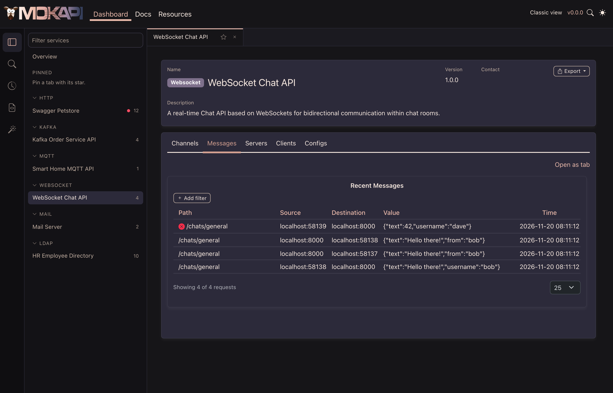
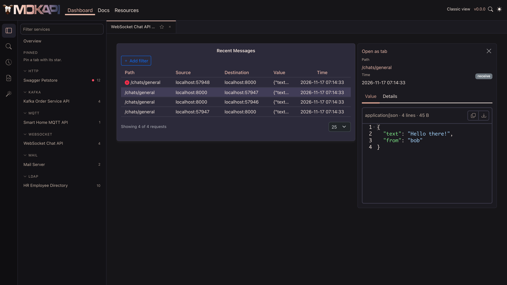
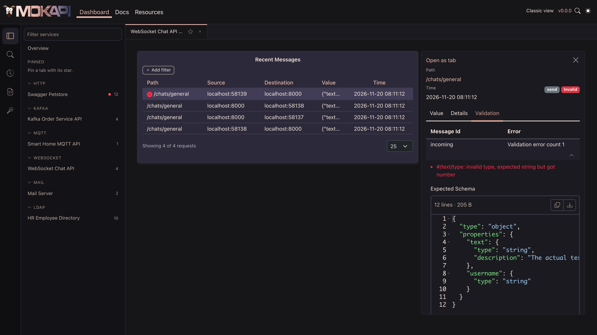
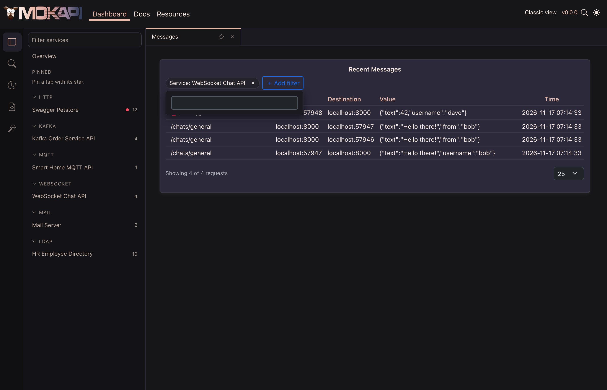
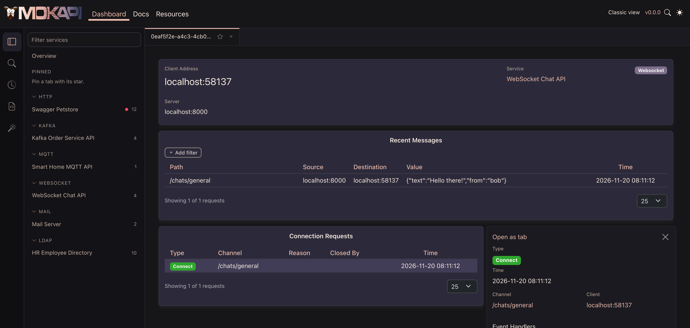

# Analyze your mocked WebSocket API in Dashboard

Every WebSocket API that Mokapi mocks gets its own view in the dashboard: its channels, the
messages that clients and Mokapi exchanged, the connected clients and the files it was loaded
from. Use it to check that a message arrived, to read its value, to see why a message was rejected
and to find the messages of one path or client.

## Overview of your mocked WebSocket API

Mocked WebSocket APIs are listed in the WebSocket group of the sidebar. Click the entry to open
the view of the API in a tab.

The top card shows the name, version and contact of the API. **Export** downloads the API as an
AsyncAPI specification in JSON or YAML. Below, the view has five sub tabs:

| Sub tab  | Content                                                                              |
|----------|--------------------------------------------------------------------------------------|
| Channels | All channels with summary, the time of the last message and the number of messages. A template path such as `/chats/{roomId}` shows how many paths it has seen. |
| Messages | The message log for this API, see [Message log](#message-log)                        |
| Servers  | The servers from the specification, with host, description and tags                  |
| Clients  | The clients connected to this API, see [Connection request log](#connection-request-log) |
| Configs  | The files Mokapi loaded for this API, for example the specification and patches      |

Click the **WebSocket** heading in the sidebar to open the WebSocket page. It shows the
[metrics](#metrics), the list of all WebSocket services and the log of all their messages.

## Metrics

In the new layout, the WebSocket page starts with three tiles: **Messages**, **Errors** and
**Last Message**. **Errors** counts the messages that ended with an error. **Last Message** shows
the time of the latest message as relative time (for example "2 minutes ago") with the absolute
time below it, or `-` if there was no activity yet.

The values cover all WebSocket services, and a value that doesn't exist yet shows `0`. They update
with [auto refresh](/docs/get-started/dashboard.md#auto-refresh). The Classic view keeps the metric
card.

## Channel view

Click a channel in the **Channels** sub tab to open it. The view shows the title, summary and
description of the channel, then two sub tabs: **Messages** with the log of this channel and
**Config** with the message definition and its schema. For a channel with a template path such as
`/chats/{roomId}`, the view of the template also lists the paths Mokapi has seen. Click a path to
open it.

## Message log

The message log lists the messages of your channels, newest first, with path, source, destination,
value and time. Source and destination are the addresses of the client and the server. The log
shows the messages that Mokapi still keeps in memory. Messages that failed validation are listed
too and marked with a red icon.

You find the log in these places:

- the **Messages** sub tab of a WebSocket service
- the view of a channel, which shows only the messages of this channel. For a channel with a
  template path such as `/chats/{roomId}`, the view of the template shows the messages of all its
  instances and the view of an instance shows only its own. The Path column is left out there.
- the view of a client, which shows only the messages of this client. The log is hidden if the
  client has no messages and no filter is active.
- the WebSocket page, which you open with the **WebSocket** heading of the sidebar. It shows the
  log of all services.
- `/dashboard/websocket/log/<service>`, the log of one service, for example
  `/dashboard/websocket/log/WebSocket Chat API`
- `/dashboard/websocket/log`, the log of all WebSocket services

In the Messages sub tab, click **Open as tab** to open the log of this service in its own dashboard
tab. A click replaces the active tab or activates the tab if it's already open. Ctrl+click,
Cmd+click or middle click opens a new tab. Click the star in the tab to pin the log, so it's
always in the **Pinned** section of the sidebar. The tab shows "Messages" for the log of all
services and "`<service>` messages" for one service.

In the Classic view, the log has the same panel, filters and **Pause** button. Only the link in a
row opens a browser tab with Ctrl+click, Cmd+click or middle click.

### Message details

Click a row to open the details of the message next to the table. The selected row is
highlighted. The top of the panel shows:

- the path (a link to the channel)
- the time
- the direction, as a badge
- an **Invalid** badge if the message failed validation

The direction badge shows `send` for a message that the client sent to Mokapi and `receive` for a
message that Mokapi sent to the client. Hover over the badge to see this as text.

Below the head, the panel has these sub tabs:

| Sub tab    | Content                                                                                      |
|------------|----------------------------------------------------------------------------------------------|
| Value      | The value of the message. This is the default.                                               |
| Details    | Client, source, destination and content type, plus the event handlers that ran for the message. |
| Validation | The validation errors of the message. Only shown for invalid messages.                       |

The Details sub tab also shows a **Script** field for messages that a script sent with
`mokapi.websocket(...).send()`. It links to the script. Messages that an event handler sent with
`client.send`, `reply` or `broadcast` have no Script field. The Event Handlers section only appears
if a handler ran for the message.

Click **Open as tab** to show the message in the full view. A click replaces the active tab,
Ctrl+click or Cmd+click opens a new one. In the new layout, Ctrl+click, Cmd+click or middle click
on a row does the same without selecting the row. In the Classic view, only the link in a row
opens a browser tab this way.

Use the arrow keys up and down to select the previous or next message of the current page. Press
`Escape` or click **Close** to close the panel. The keys are ignored while you type in an input or
a dialog is open.

The selected message is part of the address (`?message=<id>`). After a reload, the panel opens
again, and you can copy the address to share the message with a colleague. Mokapi only keeps
a limited number of messages in memory. If Mokapi has dropped the message, the panel shows
"WebSocket Message not found".

In windows narrower than 768 px, the panel is shown below the table.

### Filter messages

Active filters are shown as chips above the table. Click a chip to change its value in a popover,
click the x of a chip to remove the filter. **+ Add filter** lists the filters that aren't active
yet:

| Field   | Description                                                      |
|---------|------------------------------------------------------------------|
| Service | Only in the log of all services. Select one service.             |
| Path    | The path of a channel. The input suggests the known template paths. |
| Client  | The client id                                                    |

Each filter takes a single value. A view doesn't offer the fields it already fixes: the log of a
service has no Service filter, the view of a channel has no Path filter and the client view has no
Client filter.

For a channel with a template path such as `/chats/{roomId}`, the Path filter takes the template
path and matches the messages of all its instances. A concrete path like `/chats/general` matches
nothing.

Mokapi saves the filters in the browser, separately for the log of all services, for each
service, for each channel (and instance of a template channel) and for each client. It restores
them after a reload.

### Pause the log

While [auto refresh](/docs/get-started/dashboard.md#auto-refresh) is on, click **Pause** to stop
reloading the log, for example to read a message without new ones pushing it down the table.
Click **Resume** to reload it at once. New messages appear on top while the log runs,
and the selected message stays selected.

## Connection request log

Click a client in the **Clients** sub tab to open its view. The top card shows the client address,
the service and the server address. Below, the view has the message log of this client and the
"Connection Requests" table. A row is a `Connect` or a `Close` event with channel, reason, who
closed the connection and time. Each row opens in a detail panel, in the same way as a message.

### Request details

Click a row to open the details of the request next to the table. The top of the panel shows the
type as a badge, for example `Connect`, and the time. Below it, the panel shows:

- the channel (a link to the channel)
- the client
- for a `Close` event, the reason and who closed the connection (**Closed By**)
- the event handlers that ran, if there are any

Click **Open as tab** to show the request in the full view. A click replaces the active tab,
Ctrl+click, Cmd+click or middle click opens a new one. In the new layout, Ctrl+click, Cmd+click or
middle click on a row does the same without selecting the row. In the Classic view, only the link
in a row opens a browser tab this way. Arrow keys up and down and `Escape` work as in the
[message details](#message-details).

The selected request is part of the address (`?request=<id>`). After a reload, the panel opens
again, and you can copy the address to share the request. If Mokapi has dropped the request, the
panel shows "WebSocket Event not found".

A client view has one selection. Selecting a request closes the message panel and selecting a
message closes the request panel. **Pause** and **Resume** work as described in
[Pause the log](#pause-the-log) and also apply to the request log.

See [Using Mokapi Dashboard](/docs/get-started/dashboard.md) for tabs, Pinned and the other
parts of the layout.
